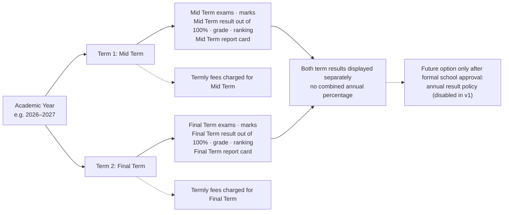

# 01 — Requirements Specification

## 1. Project overview

### 1.1 Purpose
GKSMS is a cloud-based, multi-school management platform. It digitises a school's academic, administrative and financial operations: admissions, classes, timetables, attendance, examinations, report cards, fees, finance, library, inventory and transport. The first tenant is **Gol Khatumo School**. The platform is built so that more schools can be onboarded later without code changes, and each school's data stays fully isolated.

### 1.2 Goals
| # | Goal | Measure of success |
|---|------|--------------------|
| G1 | Replace paper and spreadsheet records with one system of record | All active students, staff, fees and marks for the current academic year are managed in GKSMS |
| G2 | Accurate, auditable finances | Every payment has a receipt. Outstanding balances reconcile with charges minus payments. Free students show zero debt. |
| G3 | Fast, reliable academic reporting | Report cards and rankings for a whole class are produced as PDF in minutes, not days |
| G4 | Bilingual and accessible | Every screen and every PDF is available in Somali and English |
| G5 | Multi-school ready | A new school can be onboarded by the Super Admin through the UI, without engineering work |
| G6 | Secure | No cross-school data exposure. Sensitive actions are audit-logged. Backups are tested. |

### 1.3 Scope

**In scope (v1):** the 25 core modules listed in §2, staff-only access, Somali and English UI and PDFs, Excel import and export, PDF reports, responsive web app.

**Out of scope (v1), possible later:**
- Parent and student portals or logins
- Native mobile apps. The responsive web app comes first; a PWA can follow.
- Online payment gateway integration (EVC Plus, Zaad, eDahab, bank APIs). Payments are recorded manually in v1. See Q-F5.
- Payroll processing. Salaries may be recorded as expenses. See Q-G4.
- SMS and email delivery to parents. In-app staff notifications only. See Q-N1.
- A learning management system (LMS), e-learning, homework submission
- Platform subscription billing of schools. See Q-P2.

### 1.4 Stakeholders and users
| Stakeholder | Interest |
|-------------|----------|
| Platform owner / operator | Onboards schools, keeps the platform healthy and secure |
| School leadership (Admin, Principal) | Oversight, academic quality, reports |
| Accountant / bursar | Fee collection, receipts, balances, income and expenses |
| Teachers | Attendance, marks, timetables |
| Parents and students (indirect) | Accurate report cards, receipts and balances, delivered on paper or as PDF by staff |
| Regulators / education office (indirect) | Official reports and enrolment statistics |

### 1.5 Assumptions
- **A1.** Schools follow a Gregorian academic year divided into **terms, not semesters**. For Gol Khatumo School the year has exactly **two terms: Mid Term and Final Term** (see §1.6).
- **A2.** One currency per school. **[PROPOSED]** The default is USD. See Q-F1.
- **A3.** The default time zone is Africa/Mogadishu (EAT, UTC+3), configurable per school.
- **A4.** School working days are configurable per school (for example Saturday–Wednesday or Saturday–Thursday).
- **A5.** Internet access at schools may be slow or intermittent. The UI must be lightweight and must tolerate retries. Full offline mode is not in v1 (Q-G2).
- **A6.** Somali uses the Latin script, so no right-to-left layout or complex text shaping is needed. Fonts must still cover the full Latin character set, including apostrophes in names such as *Ba'ad*.

### 1.6 Academic structure (confirmed by the project owner)
Gol Khatumo School uses **terms, not semesters**. Each academic year has exactly **two terms**, with these official labels:

| Sequence | Official label | Role in the year |
|----------|----------------|------------------|
| 1 | **Mid Term** | First term of the academic year |
| 2 | **Final Term** | Second and last term. Its close completes the academic year (promotion decisions). Its result is independent of Mid Term (GP-2, GP-5). |

Rules:
- **AS-1.** The initial configuration of Gol Khatumo School, and of every academic year created for it, contains exactly two terms in this order: **Mid Term**, **Final Term**. The labels are used exactly as written on screens, reports and PDFs.
- **AS-2.** Terms are stored as data per academic year, not hard-coded. Each term has a sequence, label, start date and end date. The structure therefore stays configurable for future academic years: when a new year is created, it copies the previous year's term structure (Mid Term, Final Term) by default, and the School Admin sets the dates.
- **AS-3.** Terms within a year do not overlap, fall inside the academic year's dates, and are ordered Mid Term → Final Term.
- **AS-4.** The system never introduces a third term or semesters. Report types, fee periods and screens are built for the two-term structure.
- **AS-5.** Everything time-based in the year attaches to a term: exams and exam scheduling, termly fee charges, attendance summaries, results and rankings, report cards. Mid Term and Final Term results are calculated **independently** and are never combined in v1 (see §1.7).
- **AS-6.** "Mid Term" is the name of the **first term**. Each term has one examination per subject (GP-3): the **Mid Term Examination** and the **Final Term Examination**. Screens and PDFs always show the term label.

### 1.7 Grading and term results policy (confirmed by the project owner)

| Rule | Policy |
|------|--------|
| **GP-1** | The **Mid Term** result is calculated independently, on a 100% scale. |
| **GP-2** | The **Final Term** result is calculated independently, on a 100% scale. |
| **GP-3** | Each term has **one examination per subject, marked out of 100**. That mark is the subject's term mark and percentage. The overall term percentage is the student's total term marks ÷ (100 × number of counted subjects) × 100, which is the average of the subject marks. The system calculates percentages and letter grades automatically. |
| **GP-4** | The **official grading scale** (§1.8) is applied **independently** to Mid Term and to Final Term: a letter grade for each subject and an overall letter grade for each term. |
| **GP-5** | **No combined annual result in the initial release.** The system does not combine Mid Term and Final Term with any weighting (50/50, 40/60 or any other), and does **not** treat the Final Term result as the annual result. |
| **GP-6** | Both term results are displayed **separately**: on screens, in rankings, on mark sheets and on report cards. |
| **GP-7** | Rankings are per exam and per term (Mid Term, Final Term). There is no annual ranking in v1. |
| **GP-8** | At year end, the rollover preview shows each student's Final Term PASS/FAIL status next to both term results. The system does not compute a combined promotion score. Whether FAIL automatically means repeating the grade is still open (Q-E5); until it is confirmed, the Principal/School Admin confirms each promotion decision. |
| **GP-9** | No other assessments (monthly tests, coursework, quizzes) and no weighting contribute to a term result in v1. The term's single examination per subject is the term result. |
| **GP-10** | **Automatic PASS/FAIL is decided by the Final Term result:** overall Final Term percentage **≥ 50 → PASS**, **< 50 → FAIL**. |
| **GP-11** | The **Mid Term** result has no PASS/FAIL decision. It stays separate and never overrides the Final Term decision; a Mid Term percentage below 50 is shown only as grade F for that term. The Mid Term result status is shown as "Mid Term – no PASS/FAIL decision". |

**Future flexibility (architecture only, not active in v1):** the data model reserves an **annual result policy** per academic year. Its mode is `NONE` (the current policy) and is fixed to `NONE` in v1. A later release may allow an authorised School Admin to configure how Mid Term and Final Term contribute to an annual result, but only:
- after the school formally approves an annual calculation policy (approval reference, approver and date recorded);
- for academic years whose results have not yet been published, so it is never retroactive;
- with an audit-log entry for every change.
Until then no annual percentage, annual grade or annual rank is calculated, stored or shown.

### 1.8 Official grading scale (confirmed by the project owner)

| Percentage | Grade | Inclusive lower bound used by the system |
|---|---|---|
| 91–100% | **A+** | ≥ 91 |
| 85–90% | **A-** | ≥ 85 and < 91 |
| 80–84% | **B+** | ≥ 80 and < 85 |
| 75–79% | **B** | ≥ 75 and < 80 |
| 70–74% | **C+** | ≥ 70 and < 75 |
| 65–69% | **C** | ≥ 65 and < 70 |
| 60–64% | **D+** | ≥ 60 and < 65 |
| 50–59% | **D** | ≥ 50 and < 60 |
| 0–49% | **F** | < 50 |

Rules:
- **GS-1.** This is the only grading scale in the initial release. It is seeded for Gol Khatumo School as "GKS Official Grading Scale", version 1, and is **read-only** in v1.
- **GS-2.** The scale applies to subject marks and to overall term percentages, independently for Mid Term and Final Term (GP-4).
- **GS-3.** The system assigns the grade whose lower bound is the highest one not above the percentage. With whole-number marks this reproduces the table exactly. **[PROPOSED]** Overall term percentages that are not whole numbers (e.g. 90.6) are graded on the exact, unrounded value (90.6 → A-, 49.9 → F/FAIL). The school should confirm this or choose rounding to the nearest whole number first (Q-E8).
- **GS-4.** The PASS threshold (50) equals the D/F boundary. PASS/FAIL is applied only to the Final Term overall percentage (GP-10).
- **GS-5.** The school did not provide grade remarks or grade points. Those optional fields stay empty and are not printed.
- **GS-6. Future configurability:** an authorised administrator may later be allowed to edit the scale (reserved permission `grading.scale.manage`). Any change creates a new scale version, applies only to terms whose results are not yet published, and is audit-logged. Published results keep the grade and scale version they were calculated with.

---

## 2. Functional requirements

Notation: **FR-[module]-[nn]**. Priority: **M** = must have for v1, **S** = should have, **C** = could have.

### 2.1 Dashboard (DSH)
| ID | Requirement | P |
|----|-------------|---|
| FR-DSH-01 | Role-specific dashboard after login. School Admin/Principal: enrolment, attendance today, fee collection, outstanding, upcoming exams. Accountant: collections today/month, outstanding by class, recent payments. Teacher: today's timetable, sections where attendance is not yet taken, pending marks entry. | M |
| FR-DSH-02 | Super Admin platform dashboard: number of schools, active users, storage use, system health, recent platform audit events | M |
| FR-DSH-03 | KPI cards link through to the filtered list behind each number | S |
| FR-DSH-04 | Charts: attendance trend (30 days), monthly fee collection versus expected, enrolment by class and gender | S |

### 2.2 School & Academic Year Management (SCH)
| ID | Requirement | P |
|----|-------------|---|
| FR-SCH-01 | Super Admin creates, edits, suspends and reactivates schools: name (Somali/English), code, logo, address, phone, email, motto, region, currency, time zone, default language | M |
| FR-SCH-02 | Super Admin creates the first School Admin account when onboarding a school | M |
| FR-SCH-03 | School Admin maintains the school profile and official information used on PDFs (logo, stamp/signature images, principal's name, registration number) | M |
| FR-SCH-04 | Create academic years with start and end dates. Exactly one year per school is *current*. A year can be closed (read-only). | M |
| FR-SCH-05 | Each academic year contains two terms, **Mid Term** and **Final Term**, with start and end dates, created automatically with the year (AS-1 to AS-3). The School Admin edits dates; the term structure is copied to each new year. | M |
| FR-SCH-06 | Configure working days, school holidays and closure dates. Attendance is not expected on these days. | S |
| FR-SCH-07 | Year-end rollover, after Final Term results are published: the Principal/School Admin decides, with the Final Term PASS/FAIL status and both term results shown separately (GP-8), to promote students to the next grade, repeat, graduate or withdraw, with a preview before committing | M |
| FR-SCH-08 | Configure numbering formats for admission numbers, employee numbers and receipt numbers | S |

### 2.3 Student Management (STU)
| ID | Requirement | P |
|----|-------------|---|
| FR-STU-01 | Register a student: admission number (auto or manual, unique per school), names in Somali naming order (given name, father's name, grandfather's name, optional family name), gender, date of birth, place of birth, nationality, address, photo, admission date, previous school, medical notes | M |
| FR-STU-02 | Enrol the student in a section for an academic year. One active enrolment per student per year. | M |
| FR-STU-03 | Student status lifecycle: ACTIVE, SUSPENDED, TRANSFERRED, WITHDRAWN, GRADUATED, with an effective date and reason | M |
| FR-STU-04 | Transfer a student between sections within the same year. Attendance and marks history is kept. | M |
| FR-STU-05 | Student profile with tabs: details, guardians, enrolment history, attendance summary, results, fees (hidden from roles without finance permission), documents, transport, library loans | M |
| FR-STU-06 | Search and filter by name, admission number, class/section, status, gender, fee status (paid/unpaid/partial/free) | M |
| FR-STU-07 | Upload student documents (birth certificate, previous report cards), stored securely | S |
| FR-STU-08 | Duplicate detection on create: same name and date of birth, or same admission number, triggers a warning | M |
| FR-STU-09 | Excel import and export of students (see §2.26) | M |
| FR-STU-10 | Print a student ID card and a student profile as PDF | C |

### 2.4 Parent Information Management (PAR)
| ID | Requirement | P |
|----|-------------|---|
| FR-PAR-01 | Record guardians: full name, relationship, phone numbers (primary and secondary), occupation, address, national ID (optional), email (optional) | M |
| FR-PAR-02 | One guardian can be linked to several students (siblings). One student can have several guardians, one of them marked primary. | M |
| FR-PAR-03 | Mark emergency contacts and who may collect the student | S |
| FR-PAR-04 | Sibling view: all children of a guardian with a combined fee balance (finance roles only) | S |
| FR-PAR-05 | Guardians have no login in v1. The data model must allow a portal to be added later without migration pain. | M |

### 2.5 Teacher & Staff Management (STF)
| ID | Requirement | P |
|----|-------------|---|
| FR-STF-01 | Staff record: employee number, names, gender, date of birth, phone, email, address, photo, job title, department, staff type (TEACHING / NON_TEACHING), employment type (full-time, part-time, contract, volunteer), hire date, qualifications, status | M |
| FR-STF-02 | Optionally link a staff record to a user account (a teacher who logs in). Non-teaching staff such as drivers and guards may have no account. | M |
| FR-STF-03 | Record a teacher's subject specialisations | S |
| FR-STF-04 | Staff documents (CV, certificates, contract) | S |
| FR-STF-05 | Excel import and export of teachers and staff | M |
| FR-STF-06 | Record salary information (amount, payment method) for expense recording only, visible only to authorised finance roles | C (Q-G4) |

### 2.6 Class & Section Management (CLS)
| ID | Requirement | P |
|----|-------------|---|
| FR-CLS-01 | Define grade levels (classes), e.g. Grade 1 … Grade 12 or Form 1 … Form 4, with display order and level group (primary, intermediate, secondary) | M |
| FR-CLS-02 | Define sections per grade level per academic year (e.g. Grade 5-A) with capacity, room and class teacher | M |
| FR-CLS-03 | Warn when enrolment exceeds section capacity | S |
| FR-CLS-04 | Section roster with gender counts; export to Excel and PDF | M |

### 2.7 Subject Management (SUB)
| ID | Requirement | P |
|----|-------------|---|
| FR-SUB-01 | Subject catalogue: code, name (Somali/English), type (core / elective), whether it counts toward ranking | M |
| FR-SUB-02 | Assign subjects to grade levels per academic year (curriculum), with optional weekly periods | M |
| FR-SUB-03 | Teaching assignments: teacher ↔ section ↔ subject per academic year. This assignment drives what teachers can see and edit. | M |

### 2.8 Timetable Management (TTB)
| ID | Requirement | P |
|----|-------------|---|
| FR-TTB-01 | Define the bell schedule: periods per day with start and end times and breaks, per school (optionally per level group) | M |
| FR-TTB-02 | Build a weekly timetable per section: day × period → subject, teacher, room | M |
| FR-TTB-03 | Detect conflicts: a teacher in two places at once, a room double-booked, a section with two lessons in one slot | M |
| FR-TTB-04 | Views: by section, by teacher, by room. Print to PDF. | M |
| FR-TTB-05 | Automatic timetable generation | C (not v1) |

### 2.9 Student Attendance (SAT)
| ID | Requirement | P |
|----|-------------|---|
| FR-SAT-01 | Take daily attendance per section. Statuses: PRESENT, ABSENT, LATE, EXCUSED. Optional remark per student. | M |
| FR-SAT-02 | "Mark all present" and then change only the exceptions, for speed on mobile | M |
| FR-SAT-03 | Teachers can take attendance only for sections they are class teacher of or teach. Edits after a configurable window (e.g. same day) need Principal permission. | M |
| FR-SAT-04 | Attendance reports: daily absentees, monthly register per section, student attendance percentage, chronic absentees | M |
| FR-SAT-05 | Per-period (per-lesson) attendance | C (Q-A1) |
| FR-SAT-06 | Attendance is expected only on working days inside a term (Mid Term or Final Term). Attendance summaries (days present, absent, late, attendance %) are calculated per term and for the year, and feed the report cards. | M |

### 2.10 Teacher Attendance (TAT)
| ID | Requirement | P |
|----|-------------|---|
| FR-TAT-01 | Record daily staff attendance: PRESENT, ABSENT, LATE, ON_LEAVE, HALF_DAY, with check-in and check-out times | M |
| FR-TAT-02 | **[PROPOSED]** Recorded by School Admin or Principal (or a delegated staff member). Self check-in is a later option (Q-A2). | M |
| FR-TAT-03 | Leave records: type, date range, approval | S |
| FR-TAT-04 | Monthly staff attendance report and export | M |

### 2.11 Examination Management (EXM)
| ID | Requirement | P |
|----|-------------|---|
| FR-EXM-01 | Each term has exactly **one examination**, with one paper per subject: the **Mid Term Examination** and the **Final Term Examination**. There are no other exam types and no weightings in v1 (GP-3, GP-9). | M |
| FR-EXM-02 | Create the term's examination inside **Mid Term** or **Final Term**, choose the grade levels and subjects, and set the date per paper. Maximum marks are **fixed at 100** per paper. Paper dates must fall within the term. A second examination in the same term, or a second paper for the same grade level and subject, is rejected. | M |
| FR-EXM-03 | Exam lifecycle: DRAFT → SCHEDULED → MARKS_ENTRY → LOCKED → PUBLISHED. Marks are only editable during MARKS_ENTRY. Unlocking needs Principal or School Admin permission and a stated reason, and is audit-logged. | M |
| FR-EXM-04 | Exam timetable / schedule PDF per grade level, per term (Mid Term, Final Term) | S |
| FR-EXM-05 | The **official grading scale** (§1.8) is seeded and read-only in v1, and is applied independently to Mid Term and Final Term. Future: an authorised administrator may edit it, with versioning and no effect on published results (GS-6). | M |

### 2.12 Marks & Results (MRK)
| ID | Requirement | P |
|----|-------------|---|
| FR-MRK-01 | Mark entry grid per exam paper and section. Teachers see only their assigned section and subject combinations. | M |
| FR-MRK-02 | Validation: 0 ≤ mark ≤ 100 (whole numbers **[PROPOSED]**, Q-E8). Mark a student ABSENT or EXEMPT instead of entering a score. | M |
| FR-MRK-03 | Autosave drafts. Show entry progress per paper (entered / total). | S |
| FR-MRK-04 | Automatically compute per-student results for each term: subject mark out of 100, percentage and letter grade; term total, overall term percentage and overall letter grade. **Final Term:** automatic PASS (≥ 50) / FAIL (< 50). **Mid Term:** no PASS/FAIL decision (GP-3, GP-4, GP-10, GP-11). | M |
| FR-MRK-05 | The Mid Term result and the Final Term result are computed **independently**. No combined annual result, weighted or otherwise, is computed in v1 (GP-5). | M |
| FR-MRK-06 | Import marks from Excel per exam (see §2.26) | M |
| FR-MRK-07 | Mark sheets / broadsheets per section (students × subjects), one per term, to PDF and Excel | M |
| FR-MRK-08 | Annual result policy (future): an authorised School Admin configures how Mid Term and Final Term contribute to an annual result, only after formal school approval. In v1 the policy is fixed to `NONE` and this screen is not built (§1.7). | C (future) |

### 2.13 Student Ranking (RNK)
| ID | Requirement | P |
|----|-------------|---|
| FR-RNK-01 | Rank students within a section and within the whole grade level, per exam, for Mid Term and for Final Term, each ranked separately. No annual ranking in v1 (GP-7). | M |
| FR-RNK-02 | **[PROPOSED]** Ranking by percentage across subjects that count toward ranking. Ties share a rank using standard competition ranking (1, 2, 2, 4). Students with missing (not ABSENT) marks are excluded until complete. See Q-E3. | M |
| FR-RNK-03 | Top-N lists per grade level and per subject | S |
| FR-RNK-04 | Rankings are snapshotted when an exam is published so later edits cannot silently change published ranks | M |

### 2.14 Report Cards (RPC)
| ID | Requirement | P |
|----|-------------|---|
| FR-RPC-01 | Generate report cards per student, section or grade level as PDF. Two report card types: **Mid Term report card** (Mid Term results) and **Final Term report card** (Final Term results, grades, rank and the PASS/FAIL result status, with the Mid Term results shown alongside in a separate column for reference). **No combined or annual percentage, grade or rank** appears on either card (GP-5, GP-6). Layout per Q-E6. | M |
| FR-RPC-02 | Contents: school header and logo, student details, term label; for each subject the **mark (out of 100), percentage and letter grade**; term total, overall term percentage, overall letter grade, term rank, **result status** (Final Term: PASS or FAIL; Mid Term: "Mid Term – no PASS/FAIL decision"), the grading scale legend, term attendance summary, class teacher and principal remarks, signatures, school stamp, date | M |
| FR-RPC-03 | Report card language: Somali, English or bilingual | M |
| FR-RPC-04 | Class teacher and principal remarks entered per student, with optional preset comments | S |
| FR-RPC-05 | Only PUBLISHED results can appear on an official report card | M |
| FR-RPC-06 | Withhold report cards for students with outstanding fees | C (Q-F7, policy decision) |

### 2.15 Fees & Fee Structures (FEE)
| ID | Requirement | P |
|----|-------------|---|
| FR-FEE-01 | Fee categories (Tuition, Registration, Exam, Transport, Uniform, Books, …) | M |
| FR-FEE-02 | Fee structure per grade level per academic year: items with category, amount, frequency (ONE_TIME, MONTHLY, TERMLY, ANNUAL) and due rule. **TERMLY** means charged once per term, i.e. once for **Mid Term** and once for **Final Term**, due a configured number of days after the term starts. **MONTHLY** charges are labelled with the term their month falls in. | M |
| FR-FEE-03 | Generate student charges (invoices) from fee structures for a billing period (a month, or a term: Mid Term / Final Term), for all fee-paying active students, with a preview. Running it again for the same period must not create duplicates (idempotent). | M |
| FR-FEE-04 | Ad-hoc charges for an individual student (e.g. lost book, uniform) | M |
| FR-FEE-05 | Discounts: partial reductions (percentage or fixed) per student per category, e.g. sibling or staff-child discounts | S (Q-F3) |
| FR-FEE-06 | Waive or void a charge with a reason, an approval and an audit entry. Never hard-delete. | M |
| FR-FEE-07 | Excel import of fee structures and opening balances (migration of existing debts) | M |

### 2.16 Payments & Receipts (PAY)
| ID | Requirement | P |
|----|-------------|---|
| FR-PAY-01 | Record a payment: student, amount, date, method (CASH, BANK, MOBILE_MONEY with provider such as EVC Plus/Zaad/eDahab/Sahal, CHEQUE, OTHER), reference number, payer name, received by | M |
| FR-PAY-02 | Allocate the payment to outstanding charges, oldest first by default, with manual allocation available. Any excess becomes student credit. | M |
| FR-PAY-03 | Every payment produces a unique, sequential receipt number per school, formatted for example `GK-RCPT-2026-000123` | M |
| FR-PAY-04 | Receipt PDF (A4 and optionally A5/half page) with school details, itemised allocation, balance after payment, amount in words (Somali/English), cashier signature | M |
| FR-PAY-05 | Void a payment (no edits, no deletes) with a reason. **[PROPOSED]** Voiding needs a second approver (School Admin). Voided receipts stay visible, marked VOID. | M |
| FR-PAY-06 | Daily cash report per cashier and per method. End-of-day reconciliation. | M |
| FR-PAY-07 | Refunds of student credit | S |

### 2.17 Free Student Management (FRE)
| ID | Requirement | P |
|----|-------------|---|
| FR-FRE-01 | Set a student's billing status per academic year: FEE_PAYING or FREE (fully exempt), with reason category (orphan, staff child, scholarship, hardship, other), notes, effective date and approver | M |
| FR-FRE-02 | FREE students never receive generated charges and never have outstanding balances. Charge generation skips them, and the system rejects attempts to charge them, except for explicitly allowed non-tuition categories if the school enables that (Q-F2). | M |
| FR-FRE-03 | **[PROPOSED]** Changing a student to FREE mid-year stops future charges. Existing unpaid charges are not removed automatically; the approver chooses to waive them or keep them, and the choice is audit-logged (Q-F4). | M |
| FR-FRE-04 | Free status is visible as a badge on student lists, profiles and financial reports | M |
| FR-FRE-05 | Free student register report per class, with count and reason breakdown, and the estimated value of fees forgone | M |

### 2.18 Outstanding Balances (BAL)
| ID | Requirement | P |
|----|-------------|---|
| FR-BAL-01 | A student's balance is the sum of non-void charges minus discounts, minus allocated payments, minus waivers. It is computed from the ledger, never typed in. | M |
| FR-BAL-02 | Every student has exactly one fee status per period/year: **FREE**, **PAID** (balance = 0 and charges > 0), **PARTIAL** (0 < paid < due), **UNPAID** (paid = 0 and due > 0), plus **CREDIT** when overpaid | M |
| FR-BAL-03 | Outstanding report by class/section, by student, by term (Mid Term / Final Term) and by aging bucket (0–30, 31–60, 61–90, 90+ days) | M |
| FR-BAL-04 | Class-based financial report: per section, students, free count, expected, collected, outstanding, collection rate | M |
| FR-BAL-05 | Student fee statement PDF (all charges, payments and running balance) | M |

### 2.19 Income & Expenses (FIN)
| ID | Requirement | P |
|----|-------------|---|
| FR-FIN-01 | Income and expense categories, configurable per school | M |
| FR-FIN-02 | Record other income (donations, grants, rentals) and expenses (salaries, utilities, supplies, maintenance) with date, amount, method, reference, attachment (receipt image) | M |
| FR-FIN-03 | Fee payments automatically appear as income under "Student Fees". They are not entered twice. | M |
| FR-FIN-04 | Expense approval workflow (recorded → approved) | S (Q-F6) |
| FR-FIN-05 | Accounts / cash locations (main cash box, bank account, mobile money wallet), with balance per account | S |
| FR-FIN-06 | Reports: income vs expense by month, by category; profit/loss summary for a period | M |

### 2.20 Library Management (LIB)
| ID | Requirement | P |
|----|-------------|---|
| FR-LIB-01 | Book catalogue: title, author, ISBN, publisher, category, language, edition; multiple physical copies with accession numbers | M |
| FR-LIB-02 | Issue and return books to students or staff with due date; copy status (AVAILABLE, ON_LOAN, LOST, DAMAGED, RETIRED) | M |
| FR-LIB-03 | Overdue list and notifications | M |
| FR-LIB-04 | Lost/damaged book charge to the student account | S |
| FR-LIB-05 | Who manages the library: **[PROPOSED]** an optional "Librarian" custom role, or the School Admin (Q-G1) | — |

### 2.21 Inventory Management (INV)
| ID | Requirement | P |
|----|-------------|---|
| FR-INV-01 | Item catalogue: name, category, unit, SKU, reorder level, location | M |
| FR-INV-02 | Stock movements: receive (IN), issue (OUT, to a person, section or department), adjust, with quantity, unit cost, reference | M |
| FR-INV-03 | Current stock and low-stock alerts | M |
| FR-INV-04 | Suppliers; optionally post purchases as expenses | S |
| FR-INV-05 | Asset register for fixed assets (furniture, computers) with condition | C |

### 2.22 Transport Management (TRN)
| ID | Requirement | P |
|----|-------------|---|
| FR-TRN-01 | Vehicles: plate number, type, capacity, driver (staff), status, insurance and inspection dates | M |
| FR-TRN-02 | Routes and stops with pickup times | M |
| FR-TRN-03 | Assign students to a route and stop with start and end dates; capacity check | M |
| FR-TRN-04 | Transport fees through the normal fee system (TRANSPORT category, by route) | M |
| FR-TRN-05 | Route roster PDF for drivers | S |

### 2.23 Notifications (NTF)
| ID | Requirement | P |
|----|-------------|---|
| FR-NTF-01 | In-app notifications for staff users, with an unread badge and a notification centre | M |
| FR-NTF-02 | System events: attendance not taken, marks entry deadline, exam published, low stock, overdue library books, payment voided, import completed | M |
| FR-NTF-03 | Announcements: School Admin/Principal sends to all staff, to a role or to individuals | M |
| FR-NTF-04 | Channel abstraction ready for SMS/email (e.g. fee reminders to guardians) without implementing a provider in v1 | S (Q-N1) |

### 2.24 Reports & Analytics (RPT)
| ID | Requirement | P |
|----|-------------|---|
| FR-RPT-01 | Report centre listing the reports available to the user's role, with filters (academic year, term — Mid Term / Final Term, class, section, date range) | M |
| FR-RPT-02 | Every report can be exported to PDF and Excel | M |
| FR-RPT-03 | Standard reports: enrolment, attendance, exam results, ranking, report cards, fee collection, outstanding, free students, income/expense, library, inventory, transport, staff attendance | M |
| FR-RPT-04 | Analytics: trends over time and year-over-year comparisons | S |
| FR-RPT-05 | Super Admin cross-school aggregate statistics (counts only, no personal data) | S |

### 2.25 User Management & Audit Logs (USR)
| ID | Requirement | P |
|----|-------------|---|
| FR-USR-01 | School Admin creates, edits, deactivates and reactivates staff users, assigns roles, resets passwords | M |
| FR-USR-02 | Users cannot be hard-deleted once they have performed any action. They are deactivated instead. | M |
| FR-USR-03 | Force password change on first login and after an admin reset | M |
| FR-USR-04 | Session management: list active sessions, sign out other sessions; admin can revoke all sessions of a user | M |
| FR-USR-05 | Audit log viewer with filters (user, action, entity, date). School Admin sees their school; Super Admin sees platform events. | M |
| FR-USR-06 | Per-school custom roles built from the permission catalogue (e.g. Librarian, Receptionist) | S (Q-R1) |
| FR-USR-07 | Optional two-factor authentication (TOTP), required for Super Admin | S (Q-S1) |

### 2.26 Excel import & export (XLS), cross-cutting
| ID | Requirement | P |
|----|-------------|---|
| FR-XLS-01 | Downloadable templates (.xlsx) for students, guardians, teachers/staff, fee structures, opening balances and exam marks, with headers in the user's language, an instruction sheet, data validation drop-downs and example rows | M |
| FR-XLS-02 | Upload .xlsx, .xls or .csv. Size and row limits, e.g. 5 MB / 5,000 rows. | M |
| FR-XLS-03 | Validate every row on the server: required fields, types, formats, enumerations, references (e.g. section exists), business rules | M |
| FR-XLS-04 | Duplicate detection within the file and against existing records, with a configurable strategy (skip / update / flag) | M |
| FR-XLS-05 | Preview before confirmation: counts of valid, invalid, duplicate and to-be-updated rows, plus the first N rows of each | M |
| FR-XLS-06 | Row-level errors shown with row number, column and message (localized) | M |
| FR-XLS-07 | Downloadable error report: the original file plus an "Errors" column, so users can fix it and re-upload | M |
| FR-XLS-08 | Commit is all-or-nothing per import (single transaction, or batched with rollback) and is audit-logged | M |
| FR-XLS-09 | Export any filtered list to Excel (and CSV), honouring the user's permissions and active filters | M |

### 2.27 PDF reporting (PDF), cross-cutting
| ID | Requirement | P |
|----|-------------|---|
| FR-PDF-01 | Generate PDFs directly from system data. No Excel step in between. | M |
| FR-PDF-02 | Professional A4 layout (portrait and landscape) with a header (logo, school name, address, contacts), report title, academic year, generation date and user, page numbers "Page X of Y", footer and signature section | M |
| FR-PDF-03 | Tables with repeated header rows across pages, subtotals and totals; charts where appropriate | M |
| FR-PDF-04 | Preview in the browser, download, and print | M |
| FR-PDF-05 | Somali and English. Fonts embedded with full Latin coverage. | M |
| FR-PDF-06 | Bulk generation (e.g. all report cards for a grade level) runs in the background with progress, producing one merged PDF or a ZIP | M |
| FR-PDF-07 | Official documents (receipts, report cards) carry a verification code / QR that resolves to an authenticity check | C |

---

## 3. Non-functional requirements

### 3.1 Performance and capacity
| ID | Requirement |
|----|-------------|
| NFR-P-01 | **[PROPOSED]** Capacity target for v1 design: 100 schools, 3,000 students per school, 200 staff users per school, 50 concurrent users per school (Q-G3). The architecture must scale horizontally beyond this. |
| NFR-P-02 | API p95 latency < 400 ms for standard reads and writes under target load. List endpoints are always paginated (max 100 per page). |
| NFR-P-03 | First meaningful paint < 3 s on a mid-range phone over a 3G-class connection. Initial JS bundle ≤ 250 KB gzipped, with routes code-split. |
| NFR-P-04 | Single-document PDF (receipt, report card) generated in < 3 s. A class batch of 50 report cards in < 60 s in the background. |
| NFR-P-05 | Excel import validation of 5,000 rows in < 30 s. |

### 3.2 Availability and reliability
| ID | Requirement |
|----|-------------|
| NFR-R-01 | Availability target 99.5% monthly, excluding announced maintenance windows |
| NFR-R-02 | Backups: **RPO ≤ 15 minutes**, **RTO ≤ 4 hours** (see 06 — Security §9) |
| NFR-R-03 | Financial operations are ACID transactions. Receipt numbering never produces duplicates. |
| NFR-R-04 | Idempotency keys on payment creation and charge generation, so a retry on a flaky network does not double-post |
| NFR-R-05 | Graceful degradation: if the PDF worker is down, the core app keeps working and PDF jobs queue |

### 3.3 Security and privacy
| ID | Requirement |
|----|-------------|
| NFR-S-01 | Tenant isolation: no API call can read or modify another school's data. Verified by automated tests for every endpoint. |
| NFR-S-02 | OWASP ASVS Level 2 as the target baseline |
| NFR-S-03 | Personal data of minors is minimised, access-controlled and audit-logged. Financial data is visible only to authorised roles. |
| NFR-S-04 | All traffic over TLS 1.2+. Data encrypted at rest (database, backups, object storage). |
| NFR-S-05 | No secrets in the frontend bundle or in the repository |

### 3.4 Usability and accessibility
| ID | Requirement |
|----|-------------|
| NFR-U-01 | WCAG 2.1 AA: keyboard navigation, visible focus, labels on all inputs, colour contrast ≥ 4.5:1, status not conveyed by colour alone (e.g. fee badges have text) |
| NFR-U-02 | Responsive breakpoints: mobile ≥ 360 px, tablet ≥ 768 px, desktop ≥ 1280 px. Data tables turn into card lists or scroll horizontally inside a container on mobile. |
| NFR-U-03 | Somali and English switchable at any time without data loss. The preference is saved per user. School default applies at first login. |
| NFR-U-04 | Consistent design system: shared components, spacing scale, type scale, colour tokens |
| NFR-U-05 | Destructive actions need confirmation. Long operations show progress. Forms show inline validation messages. |

### 3.5 Maintainability and portability
| ID | Requirement |
|----|-------------|
| NFR-M-01 | TypeScript strict mode across the codebase. Shared types and validation schemas between frontend and backend. |
| NFR-M-02 | Automated tests: unit, integration (API + real MySQL) and end-to-end. Coverage ≥ 80% on domain services (finance, results, permissions, tenancy). |
| NFR-M-03 | Database changes only via versioned Prisma migrations, reviewed in pull requests |
| NFR-M-04 | Containerised, twelve-factor configuration via environment variables. No provider-specific SDK in domain code; storage, email and SMS sit behind adapters. |
| NFR-M-05 | OpenAPI 3.1 documentation generated from code, published at `/api/docs` in non-production environments |
| NFR-M-06 | Structured JSON logs with request ID and tenant ID. Health and readiness endpoints. Metrics. |

### 3.6 Compliance and data retention
| ID | Requirement |
|----|-------------|
| NFR-C-01 | Financial records kept for at least 7 years **[PROPOSED]** (Q-G5). Audit logs kept ≥ 2 years. |
| NFR-C-02 | A school can export all its data (Excel/CSV archive) on request |
| NFR-C-03 | Process for offboarding a school: suspend, then export, then delete after a grace period, with deletion recorded |
