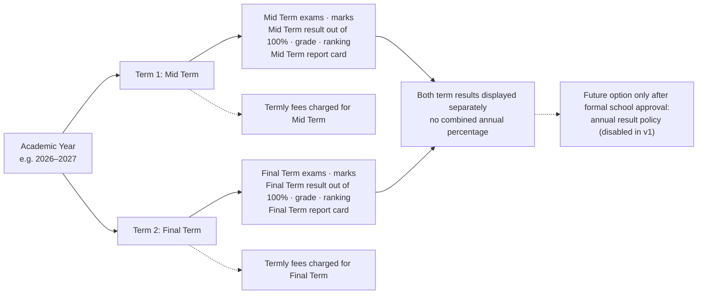

# 01 — Requirements Specification

## 1. Project overview

### 1.1 Purpose

GKSMS is a cloud-based, multi-school management platform. It digitises a school's academic, administrative and financial operations: admissions, classes, timetables, attendance, examinations, report cards, fees, finance, library, inventory and transport. The first tenant is **Gol Khatumo School**. The platform is built so that more schools can be onboarded later without code changes, and each school's data stays fully isolated.

### 1.2 Goals

| # | Goal | Measure of success |
|---|------|--------------------|
| G1 | Replace paper and spreadsheet records with one system of record | All active students, staff, fees and marks for the current academic year are managed in GKSMS |
| G2 | Accurate, auditable finances | Every payment has a receipt. Outstanding balances reconcile with charges minus payments. Free students are never charged tuition (C-17). |
| G3 | Fast, reliable academic reporting | Report cards and rankings for a whole class are produced as PDF in minutes, not days |
| G4 | Bilingual and accessible | Every screen and every PDF is available in Somali and English |
| G5 | Multi-school ready | A new school can be onboarded by the Super Admin through the UI, without engineering work |
| G6 | Secure | No cross-school data exposure. Sensitive actions are audit-logged. Backups are tested. |

### 1.3 Scope

**In scope (v1):** the 25 core modules listed in §2, staff-only access, Somali and English UI and PDFs, Excel import and export, PDF reports, responsive web app.

**Out of scope (v1), possible later:**

- Parent and student portals or logins
- Native mobile apps. The responsive web app comes first; a PWA can follow.
- Online payment gateway integration (EVC Plus, Zaad, eDahab, bank APIs). Mobile money and bank payments are recorded manually with their transaction reference in v1 (C-34).
- Payroll processing. Salaries may be recorded as expenses (C-43).
- SMS and email delivery to parents. In-app staff notifications only; the channel abstraction is kept ready (C-46).
- A learning management system (LMS), e-learning, homework submission
- Platform subscription billing of schools (C-26).
- Late-payment penalties (C-38).
- Offline mode; safe retries are built in instead (C-41).

### 1.4 Stakeholders and users

| Stakeholder | Interest |
|-------------|----------|
| Platform owner / operator | Onboards schools, keeps the platform healthy and secure |
| School leadership (Admin, Principal) | Oversight, academic quality, reports |
| Accountant / bursar | Fee collection, receipts, balances, income and expenses |
| Teachers | Attendance, marks, timetables |
| Parents and students (indirect) | Accurate report cards, receipts and balances, delivered on paper or as PDF by staff |
| Regulators / education office (indirect) | Official reports and enrolment statistics |

### 1.5 Assumptions

- **A1.** Schools follow a Gregorian academic year divided into **terms, not semesters**. For Gol Khatumo School the year has exactly **two terms: Mid Term and Final Term** (see §1.6).
- **A2.** **USD is the only currency** for the initial release. There are no multi-currency payments or exchange rates (confirmed, C-16).
- **A3.** The default time zone is Africa/Mogadishu (EAT, UTC+3), configurable per school.
- **A4.** School working days are configurable per school (for example Saturday–Wednesday or Saturday–Thursday).
- **A5.** Internet access at schools may be slow or intermittent. The UI must be lightweight and must tolerate retries. Offline mode is not in v1; safe retry mechanisms (idempotency keys, retry-safe mutations) prevent duplicate transactions (C-41).
- **A6.** Somali uses the Latin script, so no right-to-left layout or complex text shaping is needed. Fonts must still cover the full Latin character set, including apostrophes in names such as *Ba'ad*.

### 1.6 Academic structure (confirmed by the project owner)

Gol Khatumo School uses **terms, not semesters**. Each academic year has exactly **two terms**, with these official labels:

| Sequence | Official label | Role in the year |
|----------|----------------|------------------|
| 1 | **Mid Term** | First term of the academic year |
| 2 | **Final Term** | Second and last term. Its overall percentage decides PASS/FAIL and, automatically, promotion or repetition of the grade (C-05, C-06). Its result is independent of Mid Term (GP-2, GP-5). |

Rules:

- **AS-1.** The initial configuration of Gol Khatumo School, and of every academic year created for it, contains exactly two terms in this order: **Mid Term**, **Final Term**. The labels are used exactly as written on screens, reports and PDFs, in both languages (C-32).
- **AS-2.** Terms are stored as data per academic year, not hard-coded. Each term has a sequence, label, start date and end date. The structure therefore stays configurable for future academic years: when a new year is created, it copies the previous year's term structure (Mid Term, Final Term) by default, and the School Admin sets the dates.
- **AS-3.** Terms within a year do not overlap, fall inside the academic year's dates, and are ordered Mid Term → Final Term.
- **AS-4.** The system never introduces a third term or semesters. Report types, fee periods and screens are built for the two-term structure.
- **AS-5.** Everything time-based in the year attaches to a term: exams and exam scheduling, termly fee charges, attendance summaries, results and rankings, report cards. Mid Term and Final Term results are calculated **independently** and are never combined in v1 (see §1.7).
- **AS-6.** "Mid Term" is the name of the **first term**. Each term has one examination per subject (GP-3): the **Mid Term Examination** and the **Final Term Examination**. Screens and PDFs always show the term label.

### 1.7 Grading and term results policy (confirmed by the project owner)

| Rule | Policy |
|------|--------|
| **GP-1** | The **Mid Term** result is calculated independently, on a 100% scale. |
| **GP-2** | The **Final Term** result is calculated independently, on a 100% scale. |
| **GP-3** | Each term has **one examination per subject, marked out of 100**; marks may include decimals such as 67.5 (C-08). The system calculates each subject's percentage and letter grade automatically, and the **overall term percentage = (total marks obtained across all subjects taken ÷ total possible marks across those subjects) × 100** (C-05). Example: marks 67.5, 78.5, 90.5 → 236.5 ÷ 300 × 100 = 78.833…%, displayed as 78.83% → grade B, PASS. |
| **GP-4** | The **official grading scale** (§1.8) is applied **independently** to Mid Term and to Final Term: a letter grade for each subject and an overall letter grade for each term. |
| **GP-5** | **No combined annual result in the initial release.** The system does not combine Mid Term and Final Term with any weighting (50/50, 40/60 or any other), and does **not** treat the Final Term result as the annual result. |
| **GP-6** | Both term results are displayed **separately**: on screens, in rankings, on mark sheets and on report cards. |
| **GP-7** | Rankings are per exam and per term (Mid Term, Final Term). There is no annual ranking in v1. |
| **GP-8** | **End-of-year outcome is automatic (C-06):** Final Term overall percentage ≥ 50 → **PASS → PROMOTED** (moves to the next grade), or **GRADUATED** if the student is in the school's highest grade (C-09); < 50 → **FAIL → REPEAT GRADE** (repeats the same grade in the next academic year). No Principal or School Admin approval is needed, and no role can override it. The outcome is recorded and displayed. Mid Term plays no part in it. The only exception is a student who was not enrolled when the Final Term examination took place (**PENDING PLACEMENT**, GP-15). |
| **GP-9** | No other assessments (monthly tests, coursework, quizzes) and no weighting contribute to a term result in v1. The term's single examination per subject is the term result. |
| **GP-10** | **PASS/FAIL in both terms, from overall marks across all subjects (C-05, C-14):** for **Mid Term and Final Term** alike, overall percentage **≥ 50 → PASS**, **< 50 → FAIL**. A student is **not** failed for scoring below 50 in one or more individual subjects if the overall term percentage is at least 50. Subject grades (including F) are still calculated and shown separately. |
| **GP-11** | **Mid Term PASS/FAIL is an academic progress assessment only (C-14).** The Mid Term result is calculated the same way (overall percentage, overall grade, PASS/FAIL) and displayed in term results and on the Mid Term report card, but it **never triggers promotion, repetition or graduation**, is never combined with Final Term, and never overrides the Final Term decision. Only the **Final Term** PASS/FAIL decides the end-of-year outcome (C-06, C-09). |
| **GP-12** | **Exact percentages, no rounding (C-04):** grades and PASS/FAIL are determined from the exact percentage. Internally the comparison uses the exact totals (e.g. PASS when total obtained × 100 ≥ 50 × total possible), so no rounding can change a decision. Displayed percentages are shown to 2 decimals and **truncated, never rounded up**: 349 ÷ 700 = 49.857…% displays as 49.85% and is FAIL; it is never shown as 50%. |
| **GP-13** | **Subjects taken:** every subject the student was examined in that term counts toward both totals, **including subjects where the student was ABSENT** (0 out of 100, §1.9). Only EXEMPT subjects are excluded from both totals. A student's term result is calculated only when all of their marks (or ABSENT/EXEMPT statuses) are entered. |
| **GP-14** | **Graduation (C-09):** a student is in the school's highest grade **only when that grade level is explicitly configured as the school's final grade** (`is_final_grade`, set by the School Admin; exactly one per school). A missing "next grade level" is **never** treated as graduation. A student in the configured final grade who PASSES the Final Term receives **GRADUATED**, their student status becomes GRADUATED at rollover, and no next-year enrolment is created. A student in the final grade who FAILS repeats it (REPEAT GRADE). **Configuration check:** Final Term results cannot be published while any grade level in the examination has neither a next grade level nor the final-grade flag. The School Admin is shown which grade levels to configure, so a PASS student is never left without a valid outcome. |
| **GP-15** | **Late joiners (C-10):** a student who had **no active enrolment in the school on the first paper date of the Final Term examination** was not enrolled when the examination took place. They are not included in that examination: no marks and no ABSENT are recorded for them. They receive the outcome **PENDING PLACEMENT**. The **School Admin** decides their placement for the next academic year (next grade, same grade, or a final-grade student graduating), with a mandatory reason. The decision, reason, responsible user and date are stored and audit-logged. This rule **never** applies to students who were enrolled but absent: those receive ABSENT = 0/100 (C-07) and a normal automatic outcome. |
| **GP-16** | **Ranking ties (C-11):** students are ranked by their **overall term percentage** (C-05). Students with **identical exact** overall percentages share the same rank, using **standard competition ranking**: 1, 2, 2, 4. "Identical" is judged on the exact value (the totals are compared exactly), not on the 2-decimal display, so two students who both display 78.83% can still have different ranks (C-04). Applied in the same way to Mid Term and Final Term, in section and grade-level rankings, and in every term ranking report. |
| **GP-17** | **Mid Term late joiners (C-23):** a student who had **no active enrolment on the first paper date of the Mid Term examination** takes no part in it: **no marks, no ABSENT, no artificial zero and no FAIL** are recorded, no Mid Term result or rank is produced, and no Mid Term report card is issued. Their Final Term report card shows **—** for each Mid Term subject mark and **"No Mid Term Result"** in the Mid Term reference column. Final Term results are calculated normally, and the **Final Term alone** decides promotion, repetition or graduation (GP-8, GP-14). |

**Future flexibility (architecture only, not active in v1):** the data model reserves an **annual result policy** per academic year. Its mode is `NONE` (the current policy) and is fixed to `NONE` in v1. A later release may allow an authorised School Admin to configure how Mid Term and Final Term contribute to an annual result, but only:

- after the school formally approves an annual calculation policy (approval reference, approver and date recorded);
- for academic years whose results have not yet been published, so it is never retroactive;
- with an audit-log entry for every change.
Until then no annual percentage, annual grade or annual rank is calculated, stored or shown.

### 1.8 Official grading scale (confirmed by the project owner)

| Percentage | Grade | Inclusive lower bound used by the system |
|---|---|---|
| 91–100% | **A+** | ≥ 91 |
| 85–90% | **A-** | ≥ 85 and < 91 |
| 80–84% | **B+** | ≥ 80 and < 85 |
| 75–79% | **B** | ≥ 75 and < 80 |
| 70–74% | **C+** | ≥ 70 and < 75 |
| 65–69% | **C** | ≥ 65 and < 70 |
| 60–64% | **D+** | ≥ 60 and < 65 |
| 50–59% | **D** | ≥ 50 and < 60 |
| 0–49% | **F** | < 50 |

Rules:

- **GS-1.** This is the only grading scale in the initial release. It is seeded for Gol Khatumo School as "GKS Official Grading Scale", version 1, and is **read-only** in v1.
- **GS-2.** The scale applies to subject marks and to overall term percentages, independently for Mid Term and Final Term (GP-4).
- **GS-3.** The system assigns the grade whose lower bound is the highest one not above the **exact** mark or percentage, with no rounding (C-04). This also applies to decimal marks (C-08), which can fall between two rows of the table: subject mark **90.25 → A-** and **90.5 → A-** (A+ starts at 91), **84.5 → B+**, **64.5 → D+**, **49.5 → F**. Overall: 90.6% → A-, 84.99% → B+, 49.86% → F.
- **GS-4.** The PASS threshold (50) equals the D/F boundary. PASS/FAIL applies to the **overall** percentage of each term, Mid Term and Final Term (GP-10, C-14). A subject grade of F does not by itself cause FAIL. Only the Final Term PASS/FAIL decides promotion, repetition or graduation.
- **GS-5.** The school did not provide grade remarks or grade points. Those optional fields stay empty and are not printed.
- **GS-6. Future configurability:** an authorised administrator may later be allowed to edit the scale (reserved permission `grading.scale.manage`). Any change creates a new scale version, applies only to terms whose results are not yet published, and is audit-logged. Published results keep the grade and scale version they were calculated with.

### 1.9 Examination absence rule (confirmed by the project owner, C-07, revised)

There is **one fixed absence rule** for every examination. There is no alternative policy and no setting to choose one.

| Rule | Policy |
|------|--------|
| **AP-1** | When a student is absent from a subject's examination, the teacher records the status **ABSENT**, and the system **automatically assigns 0 out of 100**. A score cannot be typed together with ABSENT. |
| **AP-2** | The zero is **included in the overall term percentage**: 0 is added to the total marks obtained and 100 to the total possible marks. |
| **AP-3** | The subject grade (0 → **F**), the overall percentage and grade, ranking, the Final Term PASS/FAIL (C-05) and the end-of-year outcome (C-06) are all calculated **normally**. Example: 67.5, 55 and ABSENT → 122.5 ÷ 300 = 40.833…% (shown as 40.83%) → FAIL. |
| **AP-4** | **No School Admin option** (and no option for any other role) to select a different absence policy. There is no "absent = excluded" or "absent = pending/make-up" alternative. |
| **AP-5** | Mark sheets and report cards show the subject as **"ABSENT – 0/100"** with grade F, so the zero is never mistaken for a sat paper. |
| **AP-6** | **Never silent:** an ABSENT status on a published examination is changed (e.g. a recording mistake) only through the audited unlock → re-publish process. The previous published result version is kept, and the end-of-year outcome is recalculated where Final Term is affected. |

---

## 2. Functional requirements

Notation: **FR-[module]-[nn]**. Priority: **M** = must have for v1, **S** = should have, **C** = could have.

### 2.1 Dashboard (DSH)

| ID | Requirement | P |
|----|-------------|---|
| FR-DSH-01 | Role-specific dashboard after login. School Admin/Principal: enrolment, attendance today, fee collection, outstanding, upcoming exams. Accountant: collections today/month, outstanding by class, recent payments. Teacher: today's timetable, sections where attendance is not yet taken, pending marks entry. | M |
| FR-DSH-02 | Super Admin platform dashboard: number of schools, active users, storage use, system health, recent platform audit events | M |
| FR-DSH-03 | KPI cards link through to the filtered list behind each number | S |
| FR-DSH-04 | Charts: attendance trend (30 days), monthly fee collection versus expected, enrolment by class and gender | S |

### 2.2 School & Academic Year Management (SCH)

| ID | Requirement | P |
|----|-------------|---|
| FR-SCH-01 | Super Admin creates, edits, suspends and reactivates schools: name (Somali/English), code, logo, address, phone, email, motto, region, time zone, default language. The currency is **USD** for every school in v1 and is not selectable (C-16). | M |
| FR-SCH-02 | Super Admin creates the first School Admin account when onboarding a school | M |
| FR-SCH-03 | School Admin maintains the school profile and official information used on PDFs (logo, stamp/signature images, principal's name, registration number) | M |
| FR-SCH-04 | Create academic years with start and end dates. Exactly one year per school is *current*. A year can be closed (read-only). | M |
| FR-SCH-05 | Each academic year contains two terms, **Mid Term** and **Final Term**, with start and end dates, created automatically with the year (AS-1 to AS-3). The School Admin edits dates; the term structure is copied to each new year. | M |
| FR-SCH-06 | Configure working days, school holidays and closure dates. Attendance is not expected on these days. | S |
| FR-SCH-07 | Year-end rollover, after Final Term results are published. Outcomes are **already decided automatically** (GP-8): PROMOTED → enrolled in the next grade level; REPEAT GRADE → enrolled in the same grade level for the next academic year; GRADUATED (passing a final grade, GP-14) → no next-year enrolment, student status GRADUATED. Students with **PENDING PLACEMENT** (late joiners, GP-15) are listed separately and are placed only by the School Admin, with a reason (audited). The School Admin/Principal runs the rollover to place students into next-year sections and record withdrawals/transfers, but cannot change any PASS/FAIL or promotion/repetition outcome. Preview before commit. | M |
| FR-SCH-08 | Numbering formats for admission, employee and receipt numbers. Admission numbers use **`GK-{YYYY}-{0000}`** (C-30); receipts are sequential without gaps per school per year (C-39). | S |

### 2.3 Student Management (STU)

| ID | Requirement | P |
|----|-------------|---|
| FR-STU-01 | Register a student: admission number (auto-generated as `GK-{YYYY}-{0000}`, editable for historical students, unique per school; C-30); **student name in exactly four mandatory parts: First Name, Father's Name, Grandfather's Name, Fourth Name** (C-12); gender, date of birth, place of birth, nationality, address, photo, admission date, previous school, medical notes; and the **mandatory parent/guardian full name and phone number** (FR-PAR-01, C-13). A student cannot be saved without all four name parts and the guardian contact. | M |
| FR-STU-02 | Enrol the student in a section for an academic year. One active enrolment per student per year. | M |
| FR-STU-03 | Student status lifecycle: ACTIVE, SUSPENDED, TRANSFERRED, WITHDRAWN, GRADUATED, with an effective date and reason. Each enrolment also records its end-of-year outcome: PROMOTED, REPEAT_GRADE or GRADUATED (automatic), or PENDING_PLACEMENT followed by the School Admin's placement decision (late joiners). It is shown on the student profile and in the enrolment history. | M |
| FR-STU-04 | Transfer a student between sections within the same year. Attendance and marks history is kept. | M |
| FR-STU-05 | Student profile with tabs: details, guardians, enrolment history, attendance summary, results, fees (hidden from roles without finance permission), documents, transport, library loans | M |
| FR-STU-06 | Search and filter by name, admission number, class/section, status, gender, fee status (paid/partial/unpaid/credit) and billing status (FREE / fee-paying) (C-22) | M |
| FR-STU-07 | Upload student documents (birth certificate, previous report cards), stored securely | S |
| FR-STU-08 | Duplicate detection on create: the same four-part name and date of birth triggers a warning; the same admission number is rejected | M |
| FR-STU-09 | Excel import and export of students (see §2.26) | M |
| FR-STU-10 | Print a student ID card and a student profile as PDF | C |

### 2.4 Parent Information Management (PAR)

| ID | Requirement | P |
|----|-------------|---|
| FR-PAR-01 | **Mandatory for every student (C-13):** a primary parent/guardian with **Full Name** and **Phone Number** is captured in the student registration record and cannot be left empty or removed. Without them the student cannot be registered, imported or saved. Validation: full name 2–150 characters, letters, spaces, apostrophes and hyphens; phone number required and valid, accepted in local or international format and stored normalised in international form (E.164). The default country code is **[PROPOSED] (Q-M1)** +252 (school setting). Optional extra fields: relationship, secondary phone, occupation, address, national ID, email. | M |
| FR-PAR-06 | Authorised school staff can see the guardian name and phone on the student profile, class lists and the guardian contact report, to contact parents or guardians when necessary (access in 04 — Roles & Permissions). Changes to guardian contact details are audit-logged. | M |
| FR-PAR-02 | One guardian can be linked to several students (siblings). One student can have additional guardians besides the mandatory primary guardian. The primary guardian can be **replaced** but never removed without a replacement. | M |
| FR-PAR-03 | Mark emergency contacts and who may collect the student | S |
| FR-PAR-04 | Sibling view: all children of a guardian with a combined fee balance (finance roles only) | S |
| FR-PAR-05 | Guardians have no login in v1. The data model must allow a portal to be added later without migration pain. | M |

### 2.5 Teacher & Staff Management (STF)

| ID | Requirement | P |
|----|-------------|---|
| FR-STF-01 | Staff record: employee number, names, gender, date of birth, phone, email, address, photo, job title, department, staff type (TEACHING / NON_TEACHING), employment type (full-time, part-time, contract, volunteer), hire date, qualifications, status | M |
| FR-STF-02 | Optionally link a staff record to a user account (a teacher who logs in). Non-teaching staff such as drivers and guards may have no account. | M |
| FR-STF-03 | Record a teacher's subject specialisations | S |
| FR-STF-04 | Staff documents (CV, certificates, contract) | S |
| FR-STF-05 | Excel import and export of teachers and staff | M |
| FR-STF-06 | Record salary information (amount, payment method) for expense recording only, visible only to authorised finance roles. Payroll is out of scope (C-43). | C |

### 2.6 Class & Section Management (CLS)

| ID | Requirement | P |
|----|-------------|---|
| FR-CLS-01 | Define grade levels (classes), e.g. Grade 1 … Grade 12 or Form 1 … Form 4, with display order, level group (primary, intermediate, secondary) and **next grade level**. Exactly one grade level is **explicitly marked as the school's final (highest) grade**; it has no next grade level. Every other grade level must have a next grade level before Final Term results can be published (GP-14, C-09). | M |
| FR-CLS-02 | Define sections per grade level per academic year (e.g. Grade 5-A) with capacity, room and class teacher | M |
| FR-CLS-03 | Warn when enrolment exceeds section capacity | S |
| FR-CLS-04 | Section roster with gender counts; export to Excel and PDF. For roles with guardian access, an optional column shows the primary guardian name and phone. | M |

### 2.7 Subject Management (SUB)

| ID | Requirement | P |
|----|-------------|---|
| FR-SUB-01 | Subject catalogue: code, name (Somali/English), type (core / elective). Every subject a student is examined in counts toward the overall term percentage, and therefore toward ranking (C-05, C-11). | M |
| FR-SUB-02 | Assign subjects to grade levels per academic year (curriculum), with optional weekly periods | M |
| FR-SUB-03 | Teaching assignments: teacher ↔ section ↔ subject per academic year. This assignment drives what teachers can see and edit. | M |

### 2.8 Timetable Management (TTB)

| ID | Requirement | P |
|----|-------------|---|
| FR-TTB-01 | Define the bell schedule: periods per day with start and end times and breaks, per school (optionally per level group) | M |
| FR-TTB-02 | Build a weekly timetable per section: day × period → subject, teacher, room | M |
| FR-TTB-03 | Detect conflicts: a teacher in two places at once, a room double-booked, a section with two lessons in one slot | M |
| FR-TTB-04 | Views: by section, by teacher, by room. Print to PDF. | M |
| FR-TTB-05 | Automatic timetable generation | C (not v1) |

### 2.9 Student Attendance (SAT)

| ID | Requirement | P |
|----|-------------|---|
| FR-SAT-01 | Take **daily** attendance per section (C-31). Statuses: PRESENT, ABSENT, LATE, EXCUSED. Optional remark per student. | M |
| FR-SAT-02 | "Mark all present" and then change only the exceptions, for speed on mobile | M |
| FR-SAT-03 | Teachers can take attendance only for sections they are class teacher of or teach. They can edit it **until midnight (school time zone) on the same day**; later edits need the Principal (`attendance.edit_locked`) and are audited (C-31). | M |
| FR-SAT-04 | Attendance reports: daily absentees, monthly register per section, student attendance percentage, chronic absentees | M |
| FR-SAT-05 | Per-period (per-lesson) attendance | C (not v1, C-31) |
| FR-SAT-06 | Attendance is expected only on working days inside a term (Mid Term or Final Term). Attendance summaries (days present, absent, late, attendance %) are calculated per term and for the year, and feed the report cards. | M |

### 2.10 Teacher Attendance (TAT)

| ID | Requirement | P |
|----|-------------|---|
| FR-TAT-01 | Record daily staff attendance: PRESENT, ABSENT, LATE, ON_LEAVE, HALF_DAY, with check-in and check-out times | M |
| FR-TAT-02 | Staff attendance is recorded by the **School Admin or Principal**. No self check-in in v1 (C-31). | M |
| FR-TAT-03 | Leave records: type, date range, approval | S |
| FR-TAT-04 | Monthly staff attendance report and export | M |

### 2.11 Examination Management (EXM)

| ID | Requirement | P |
|----|-------------|---|
| FR-EXM-01 | Each term has exactly **one examination**, with one paper per subject: the **Mid Term Examination** and the **Final Term Examination**. There are no other exam types and no weightings in v1 (GP-3, GP-9). | M |
| FR-EXM-02 | Create the term's examination inside **Mid Term** or **Final Term**, choose the grade levels and subjects, and set the date per paper. Maximum marks are **fixed at 100** per paper. Paper dates must fall within the term. A second examination in the same term, or a second paper for the same grade level and subject, is rejected. | M |
| FR-EXM-03 | Exam lifecycle: DRAFT → SCHEDULED → MARKS_ENTRY → LOCKED → PUBLISHED. Marks are only editable during MARKS_ENTRY. Unlocking needs Principal or School Admin permission and a stated reason, and is audit-logged. | M |
| FR-EXM-04 | Exam timetable / schedule PDF per grade level, per term (Mid Term, Final Term) | S |
| FR-EXM-05 | The **official grading scale** (§1.8) is seeded and read-only in v1, and is applied independently to Mid Term and Final Term. Future: an authorised administrator may edit it, with versioning and no effect on published results (GS-6). | M |
| FR-EXM-06 | **Examination absence rule (fixed):** a student absent from a subject's examination is recorded as ABSENT with an automatic 0/100. The zero counts in the overall term percentage, and grades, ranking and PASS/FAIL are calculated normally. No setting exists to choose another absence policy (§1.9, AP-1 to AP-6). | M |

### 2.12 Marks & Results (MRK)

| ID | Requirement | P |
|----|-------------|---|
| FR-MRK-01 | Mark entry grid per exam paper and section. Teachers see only their assigned section and subject combinations. | M |
| FR-MRK-02 | Validation: mark from **0.00 to 100.00 with up to two decimal places** (e.g. 67.25, 78.50, 90.25) (C-08). Values above 100, below 0 or with more than two decimal places (e.g. 67.255) are **rejected, never rounded**. Record **ABSENT** (automatic 0/100) or **EXEMPT** instead of a score. | M |
| FR-MRK-03 | Autosave drafts. Show entry progress per paper (entered / total). | S |
| FR-MRK-04 | Automatically compute per-student results for each term (Mid Term and Final Term): each subject's mark out of 100, percentage and letter grade; total marks obtained, total possible marks, overall term percentage (exact, C-04, C-05), overall letter grade and **PASS (≥ 50) / FAIL (< 50)**. **Mid Term** PASS/FAIL is a progress assessment only (C-14). **Final Term** PASS/FAIL also sets the automatic end-of-year outcome (PROMOTED / REPEAT GRADE / GRADUATED) (GP-3, GP-8, GP-10 to GP-15). | M |
| FR-MRK-05 | The Mid Term result and the Final Term result are computed **independently**. No combined annual result, weighted or otherwise, is computed in v1 (GP-5). | M |
| FR-MRK-06 | Import marks from Excel per exam (see §2.26) | M |
| FR-MRK-07 | Mark sheets / broadsheets per section (students × subjects), one per term, to PDF and Excel | M |
| FR-MRK-08 | Annual result policy (future): an authorised School Admin configures how Mid Term and Final Term contribute to an annual result, only after formal school approval. In v1 the policy is fixed to `NONE` and this screen is not built (§1.7). | C (future) |

### 2.13 Student Ranking (RNK)

| ID | Requirement | P |
|----|-------------|---|
| FR-RNK-01 | Rank students within a section and within the whole grade level, per exam, for Mid Term and for Final Term, each ranked separately. No annual ranking in v1 (GP-7). | M |
| FR-RNK-02 | Ranking by overall term percentage (C-05). Students with identical exact percentages share a rank using **standard competition ranking** (1, 2, 2, 4), consistently in all term ranking reports (GP-16, C-11). Results, and therefore ranks, are produced only when every student's marks are complete; late joiners without a result for a term (GP-15, GP-17) are not ranked for that term. | M |
| FR-RNK-03 | Top-N lists per grade level and per subject | S |
| FR-RNK-04 | Rankings are snapshotted when an exam is published so later edits cannot silently change published ranks | M |

### 2.14 Report Cards (RPC)

| ID | Requirement | P |
|----|-------------|---|
| FR-RPC-01 | Generate report cards per student, section or grade level as PDF. Two report card types: **Mid Term report card** (Mid Term results, grades, rank and PASS/FAIL as a progress assessment, with no outcome) and **Final Term report card** (Final Term results, grades, rank, the PASS/FAIL result status and the **end-of-year outcome** ("Promoted to {next grade}" / "Repeats {grade}" / "Graduated"), with the Mid Term results shown alongside (or "No Mid Term Result" for a Mid Term late joiner, GP-17) in a separate column labelled **"Reference Only – Not Combined"**). **No combined or annual percentage, grade or rank** appears on either card (GP-5, GP-6). Layout **confirmed** in [09 — Report Card Layout](09-report-card-layout.md) (C-20). | M |
| FR-RPC-02 | Contents (C-20): school header and logo, student details including the **four-part name** (C-12), term label; for each subject the **mark (out of 100), percentage and letter grade**; **total marks obtained / total possible marks**, overall term percentage (2 decimals, truncated), overall letter grade, **section rank and grade rank**, **result status** (Mid Term: PASS or FAIL, labelled "academic progress assessment – does not affect promotion"; Final Term: PASS or FAIL plus the end-of-year outcome), the grading scale legend, term attendance summary, class teacher and principal remarks, signatures of class teacher, principal and **parent/guardian**, school stamp, issue date and **document number**. **Not printed:** student photo, parent/guardian name and phone (C-20). | M |
| FR-RPC-03 | Report card language: **bilingual, Somali first and English second** (C-20). The Somali wording is provisional until reviewed by a Somali language specialist (Q-G6). | M |
| FR-RPC-04 | Class teacher and principal remarks entered per student, with optional preset comments | S |
| FR-RPC-05 | Only PUBLISHED results can appear on an official report card | M |
| FR-RPC-06 | Report cards are **never withheld** for unpaid fees in v1, and there is no setting to do so (C-36). | M |

### 2.15 Fees & Fee Structures (FEE)

| ID | Requirement | P |
|----|-------------|---|
| FR-FEE-01 | Fee categories (Tuition, Registration, Exam, Transport, Uniform, Books, …) | M |
| FR-FEE-02 | Fee structure per grade level per academic year: items with category, amount, frequency and due rule. The supported frequencies are **MONTHLY, TERMLY and ONE_TIME**; **ANNUAL is not supported** (C-19). **ONE_TIME** means charged once per enrolment in the academic year (e.g. registration). **TERMLY** means charged once per term, i.e. once for **Mid Term** and once for **Final Term**, due a configured number of days after the term starts. **MONTHLY** charges are labelled with the term their month falls in. | M |
| FR-FEE-03 | Generate student charges (invoices) from fee structures for a billing period (a month, a term — Mid Term / Final Term — or the one-time charges of the academic year), for all active students, with a preview. **Tuition** items are skipped for FREE students; all other items are charged to them normally (C-17). Running it again for the same period must not create duplicates (idempotent). | M |
| FR-FEE-04 | Ad-hoc charges for an individual student (e.g. lost book, uniform) | M |
| FR-FEE-05 | Discounts: **fixed-amount or percentage** reductions per student per category (e.g. sibling or staff-child discounts), each **subject to approval** (C-33) | M |
| FR-FEE-06 | Waive or void a charge with a reason, an approval and an audit entry. Never hard-delete. | M |
| FR-FEE-07 | Excel import of fee structures and opening balances (migration of existing debts) | M |

### 2.16 Payments & Receipts (PAY)

| ID | Requirement | P |
|----|-------------|---|
| FR-PAY-01 | Record a payment: student, amount, date, method (CASH, BANK, MOBILE_MONEY with provider such as EVC Plus/Zaad/eDahab/Sahal, CHEQUE, OTHER), reference number (mandatory for mobile money; recorded manually, no provider integration in v1, C-34), payer name, received by | M |
| FR-PAY-02 | Allocate the payment to outstanding charges, oldest first by default, with manual allocation available. Any excess becomes student credit. | M |
| FR-PAY-03 | Every payment produces a unique receipt number, **sequential without gaps** per school per year, formatted for example `GK-RCPT-2026-000123` (C-39) | M |
| FR-PAY-04 | Receipt PDF, **A4 by default with an optional half-page (A5) format**, **bilingual labels**, school details, itemised allocation, balance after payment, amount in words (Somali/English), cashier signature (C-39) | M |
| FR-PAY-05 | Void a payment (no edits, no deletes) with a reason. **[PROPOSED] (Q-M3)** Voiding needs School Admin approval. Voided receipts stay visible, marked VOID. | M |
| FR-PAY-06 | Daily cash report per cashier and per method. End-of-day reconciliation. | M |
| FR-PAY-07 | Refunds of student credit | S |

### 2.17 Free Student Management (FRE)

| ID | Requirement | P |
|----|-------------|---|
| FR-FRE-01 | Set a student's billing status per academic year: FEE_PAYING or FREE (**exempt from tuition fees only**, C-17), with reason category (orphan, staff child, scholarship, hardship, other), notes, effective date and approver | M |
| FR-FRE-02 | **FREE students never receive tuition charges** and never owe tuition. Charge generation skips tuition items for them, and the system rejects any attempt to create a tuition charge for them. **Other configured charges** (e.g. books, uniforms, transport, registration, exam fees) **still apply** to FREE students and are generated, paid and reported normally (C-17). | M |
| FR-FRE-03 | **Becoming FREE during the year (C-18):** when a student's status changes to FREE mid-year, **future tuition charges stop** (other charges continue, C-17). Existing unpaid charges are not changed automatically: the **School Admin** decides whether they **remain payable (KEEP)** or are **waived (WAIVE)**. The decision, reason, responsible user and date are recorded in the audit log. | M |
| FR-FRE-04 | The FREE status is **always** visible as a badge on student lists, profiles, statements and financial reports. Next to it, any non-tuition charges show their own fee status (PAID, PARTIAL, UNPAID, CREDIT). FREE never implies that those charges are waived (C-22). | M |
| FR-FRE-05 | Free student register report per class, with count and reason breakdown, and the estimated value of tuition forgone (C-17) | M |

### 2.18 Outstanding Balances (BAL)

| ID | Requirement | P |
|----|-------------|---|
| FR-BAL-01 | A student's balance is the sum of non-void charges minus discounts, minus allocated payments, minus waivers. It is computed from the ledger, never typed in. | M |
| FR-BAL-02 | Each student has a **billing status** (FEE_PAYING or FREE, FR-FRE-01) and, per period/year, a **fee status** derived from the ledger: **PAID** (balance = 0 and charges > 0), **PARTIAL** (0 < paid < due), **UNPAID** (paid = 0 and due > 0), or **CREDIT** when overpaid. For a FREE student the **FREE** status is **always displayed**; their non-tuition charges (books, uniforms, transport, …) keep their **own** fee status, shown next to FREE. A FREE student with no charges in the period shows FREE only. FREE never implies that non-tuition charges are waived; only an explicit, approved waiver does that (C-17, C-22). | M |
| FR-BAL-03 | Outstanding report by class/section, by student, by term (Mid Term / Final Term) and by aging bucket (0–30, 31–60, 61–90, 90+ days). Unpaid non-tuition charges of FREE students are included and marked with the FREE badge (C-22). | M |
| FR-BAL-04 | Class-based financial report: per section, students, free count, expected, collected, outstanding, collection rate. Expected and outstanding include the non-tuition charges of FREE students (C-22). | M |
| FR-BAL-05 | Student fee statement PDF (all charges, payments and running balance). Balances from previous academic years stay on that year's record and are shown as arrears (C-37). | M |

### 2.19 Income & Expenses (FIN)

| ID | Requirement | P |
|----|-------------|---|
| FR-FIN-01 | Income and expense categories, configurable per school | M |
| FR-FIN-02 | Record other income (donations, grants, rentals) and expenses (salaries, utilities, supplies, maintenance) with date, amount, method, reference, attachment (receipt image) | M |
| FR-FIN-03 | Fee payments automatically appear as income under "Student Fees". They are not entered twice. | M |
| FR-FIN-04 | Expense approval workflow (RECORDED → APPROVED). Expenses are recorded by the Accountant and **recognised in financial reports only after School Admin approval** (C-35). | M |
| FR-FIN-05 | Accounts / cash locations (main cash box, bank account, mobile money wallet), with balance per account | S |
| FR-FIN-06 | Reports: income vs expense by month, by category; profit/loss summary for a period. Only APPROVED expenses are counted (C-35). | M |

### 2.20 Library Management (LIB)

| ID | Requirement | P |
|----|-------------|---|
| FR-LIB-01 | Book catalogue: title, author, ISBN, publisher, category, language, edition; multiple physical copies with accession numbers | M |
| FR-LIB-02 | Issue and return books to students or staff with due date; copy status (AVAILABLE, ON_LOAN, LOST, DAMAGED, RETIRED) | M |
| FR-LIB-03 | Overdue list and notifications | M |
| FR-LIB-04 | Lost/damaged book charge to the student account | S |
| FR-LIB-05 | The library is managed by a **Librarian custom role** (C-27) or the **School Admin** (C-40) | M |

### 2.21 Inventory Management (INV)

| ID | Requirement | P |
|----|-------------|---|
| FR-INV-01 | Item catalogue: name, category, unit, SKU, reorder level, location | M |
| FR-INV-02 | Stock movements: receive (IN), issue (OUT, to a person, section or department), adjust, with quantity, unit cost, reference | M |
| FR-INV-03 | Current stock and low-stock alerts | M |
| FR-INV-04 | Suppliers; optionally post purchases as expenses | S |
| FR-INV-05 | Asset register for fixed assets (furniture, computers) with condition | C |

### 2.22 Transport Management (TRN)

| ID | Requirement | P |
|----|-------------|---|
| FR-TRN-01 | Vehicles: plate number, type, capacity, driver (staff), status, insurance and inspection dates | M |
| FR-TRN-02 | Routes and stops with pickup times | M |
| FR-TRN-03 | Assign students to a route and stop with start and end dates; capacity check | M |
| FR-TRN-04 | Transport fees through the normal fee system (TRANSPORT category, by route). Transport is not tuition, so it also applies to FREE students (C-17). | M |
| FR-TRN-05 | Route roster PDF for drivers | S |

### 2.23 Notifications (NTF)

| ID | Requirement | P |
|----|-------------|---|
| FR-NTF-01 | In-app notifications for staff users, with an unread badge and a notification centre | M |
| FR-NTF-02 | System events: attendance not taken, marks entry deadline, exam published, low stock, overdue library books, payment voided, import completed | M |
| FR-NTF-03 | Announcements: School Admin/Principal sends to all staff, to a role or to individuals | M |
| FR-NTF-04 | Channel abstraction ready for SMS/email (e.g. fee reminders to guardians). **No SMS or email provider in v1** (C-46). | S |

### 2.24 Reports & Analytics (RPT)

| ID | Requirement | P |
|----|-------------|---|
| FR-RPT-01 | Report centre listing the reports available to the user's role, with filters (academic year, term — Mid Term / Final Term, class, section, date range) | M |
| FR-RPT-02 | Every report can be exported to PDF and Excel | M |
| FR-RPT-03 | Standard reports: enrolment, **parent/guardian contact list per section** (student four-part name, guardian full name, phone; C-13), attendance, exam results, ranking, report cards, fee collection, outstanding, free students, income/expense, library, inventory, transport, staff attendance | M |
| FR-RPT-04 | Analytics: trends over time and year-over-year comparisons | S |
| FR-RPT-05 | Super Admin cross-school aggregate statistics (counts only, no personal data) | S |

### 2.25 User Management & Audit Logs (USR)

| ID | Requirement | P |
|----|-------------|---|
| FR-USR-01 | School Admin creates, edits, deactivates and reactivates staff users, assigns roles, resets passwords. Each user logs in with **either an email address or a phone number** (at least one is required, each globally unique) plus a password (C-15). | M |
| FR-USR-02 | Users cannot be hard-deleted once they have performed any action. They are deactivated instead. | M |
| FR-USR-03 | Force password change on first login and after an admin reset | M |
| FR-USR-04 | Session management: list active sessions, sign out other sessions; admin can revoke all sessions of a user | M |
| FR-USR-05 | Audit log viewer with filters (user, action, entity, date). School Admin sees their school; Super Admin sees platform events. | M |
| FR-USR-06 | Per-school custom roles built from the permission catalogue (e.g. Librarian, Receptionist), delivered in **Phase 3**; platform permissions cannot be granted (C-27) | M |
| FR-USR-07 | Two-factor authentication (TOTP): **mandatory for Super Admin**, **optional for School Admin and Accountant** (C-29) | M |

### 2.26 Excel import & export (XLS), cross-cutting

| ID | Requirement | P |
|----|-------------|---|
| FR-XLS-01 | Downloadable templates (.xlsx) for students, guardians, teachers/staff, fee structures, opening balances and exam marks, with headers in the user's language, an instruction sheet, data validation drop-downs and example rows | M |
| FR-XLS-02 | Upload .xlsx, .xls or .csv. Size and row limits, e.g. 5 MB / 5,000 rows. | M |
| FR-XLS-03 | Validate every row on the server: required fields, types, formats, enumerations, references (e.g. section exists), business rules | M |
| FR-XLS-04 | Duplicate detection within the file and against existing records, with a configurable strategy (skip / update / flag) | M |
| FR-XLS-05 | Preview before confirmation: counts of valid, invalid, duplicate and to-be-updated rows, plus the first N rows of each | M |
| FR-XLS-06 | Row-level errors shown with row number, column and message (localized) | M |
| FR-XLS-07 | Downloadable error report: the original file plus an "Errors" column, so users can fix it and re-upload | M |
| FR-XLS-08 | Commit is all-or-nothing per import (single transaction, or batched with rollback) and is audit-logged | M |
| FR-XLS-09 | Export any filtered list to Excel (and CSV), honouring the user's permissions and active filters | M |
| FR-XLS-10 | **Student import template (C-12, C-13).** Required columns: Admission No. (or auto), **First Name**, **Father's Name**, **Grandfather's Name**, **Fourth Name**, Gender, Date of Birth, Grade, Section, **Parent/Guardian Full Name**, **Parent/Guardian Phone**. Optional: Guardian Relationship, Guardian Secondary Phone, Place of Birth, Nationality, Address, Admission Date, Previous School. Row errors include a missing name part, missing guardian name or phone, and an invalid phone format. **[PROPOSED] (Q-M2)** If a guardian with the same normalised phone number already exists, the preview proposes linking the student to that guardian (siblings) instead of creating a duplicate, and the user confirms. The guardians template remains available for additional guardians. | M |

### 2.27 PDF reporting (PDF), cross-cutting

| ID | Requirement | P |
|----|-------------|---|
| FR-PDF-01 | Generate PDFs directly from system data. No Excel step in between. | M |
| FR-PDF-02 | Professional A4 layout (portrait and landscape) with a header (logo, school name, address, contacts), report title, academic year, generation date and user, page numbers "Page X of Y", footer and signature section | M |
| FR-PDF-03 | Tables with repeated header rows across pages, subtotals and totals; charts where appropriate | M |
| FR-PDF-04 | Preview in the browser, download, and print | M |
| FR-PDF-05 | Somali and English. Fonts embedded with full Latin coverage. | M |
| FR-PDF-06 | Bulk generation (e.g. all report cards for a grade level) runs in the background with progress, producing one merged PDF or a ZIP | M |
| FR-PDF-07 | Official documents (receipts, report cards) carry a verification code / QR that resolves to an authenticity check. **Deferred to a future release** (C-20); in v1 report cards print a unique document number. | C (future) |

---

## 3. Non-functional requirements

### 3.1 Performance and capacity

| ID | Requirement |
|----|-------------|
| NFR-P-01 | Capacity target for v1 design: **100 schools with up to 3,000 students per school** (C-42). Working load-test assumptions (not confirmed by the project owner): 200 staff users and 50 concurrent users per school (Q-M9). The architecture must scale horizontally beyond this. |
| NFR-P-02 | API p95 latency < 400 ms for standard reads and writes under target load. List endpoints are always paginated (max 100 per page). |
| NFR-P-03 | First meaningful paint < 3 s on a mid-range phone over a 3G-class connection. Initial JS bundle ≤ 250 KB gzipped, with routes code-split. |
| NFR-P-04 | Single-document PDF (receipt, report card) generated in < 3 s. A class batch of 50 report cards in < 60 s in the background. |
| NFR-P-05 | Excel import validation of 5,000 rows in < 30 s. |

### 3.2 Availability and reliability

| ID | Requirement |
|----|-------------|
| NFR-R-01 | Availability target 99.5% monthly, excluding announced maintenance windows |
| NFR-R-02 | Backups: **RPO ≤ 15 minutes**, **RTO ≤ 4 hours** (see 06 — Security §9) |
| NFR-R-03 | Financial operations are ACID transactions. Receipt numbering never produces duplicates. |
| NFR-R-04 | Idempotency keys on payment creation, charge generation and import commits, so a retry on a flaky network never double-posts (C-41) |
| NFR-R-05 | Graceful degradation: if the PDF worker is down, the core app keeps working and PDF jobs queue |

### 3.3 Security and privacy

| ID | Requirement |
|----|-------------|
| NFR-S-01 | **Tenant isolation (C-21):** all schools share one database; every school-owned record carries `school_id`. No API call, report, export, file download or background job can read or modify another school's data. School Admins and all other school users are limited to their own school. Isolation is enforced server-side in five layers (02 — Architecture §6.2), never only in the frontend, and verified by automated tests for every endpoint. |
| NFR-S-02 | OWASP ASVS Level 2 as the target baseline |
| NFR-S-03 | Personal data of minors is minimised, access-controlled and audit-logged. Financial data is visible only to authorised roles. |
| NFR-S-04 | All traffic over TLS 1.2+. Data encrypted at rest (database, backups, object storage). |
| NFR-S-05 | No secrets in the frontend bundle or in the repository |

### 3.4 Usability and accessibility

| ID | Requirement |
|----|-------------|
| NFR-U-01 | WCAG 2.1 AA: keyboard navigation, visible focus, labels on all inputs, colour contrast ≥ 4.5:1, status not conveyed by colour alone (e.g. fee badges have text) |
| NFR-U-02 | Responsive breakpoints: mobile ≥ 360 px, tablet ≥ 768 px, desktop ≥ 1280 px. Data tables turn into card lists or scroll horizontally inside a container on mobile. |
| NFR-U-03 | Somali and English switchable at any time without data loss. The preference is saved per user. School default applies at first login. |
| NFR-U-04 | Consistent design system: shared components, spacing scale, type scale, colour tokens |
| NFR-U-05 | Destructive actions need confirmation. Long operations show progress. Forms show inline validation messages. |

### 3.5 Maintainability and portability

| ID | Requirement |
|----|-------------|
| NFR-M-01 | TypeScript strict mode across the codebase. Shared types and validation schemas between frontend and backend. |
| NFR-M-02 | Automated tests: unit, integration (API + real MySQL) and end-to-end. Coverage ≥ 80% on domain services (finance, results, permissions, tenancy). |
| NFR-M-03 | Database changes only via versioned Prisma migrations, reviewed in pull requests |
| NFR-M-04 | Containerised, twelve-factor configuration via environment variables. No provider-specific SDK in domain code; storage, email and SMS sit behind adapters. |
| NFR-M-05 | OpenAPI 3.1 documentation generated from code, published at `/api/docs` in non-production environments |
| NFR-M-06 | Structured JSON logs with request ID and tenant ID. Health and readiness endpoints. Metrics. |

### 3.6 Compliance and data retention

| ID | Requirement |
|----|-------------|
| NFR-C-01 | Financial records kept for **7 years** and audit logs for **2 years**, subject to applicable legal requirements (C-44). Retention of student records: Q-M8. |
| NFR-C-02 | A school can export all its data (Excel/CSV archive) on request |
| NFR-C-03 | Process for offboarding a school: suspend, then export, then delete after a grace period, with deletion recorded |
