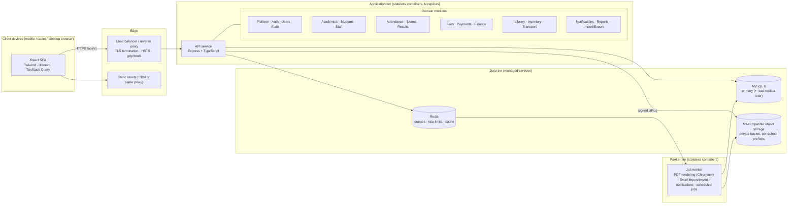
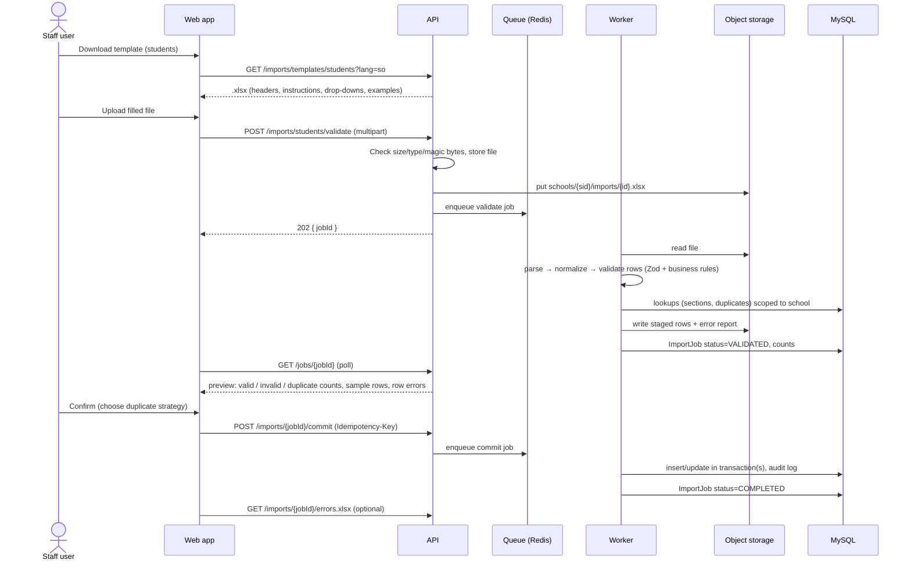
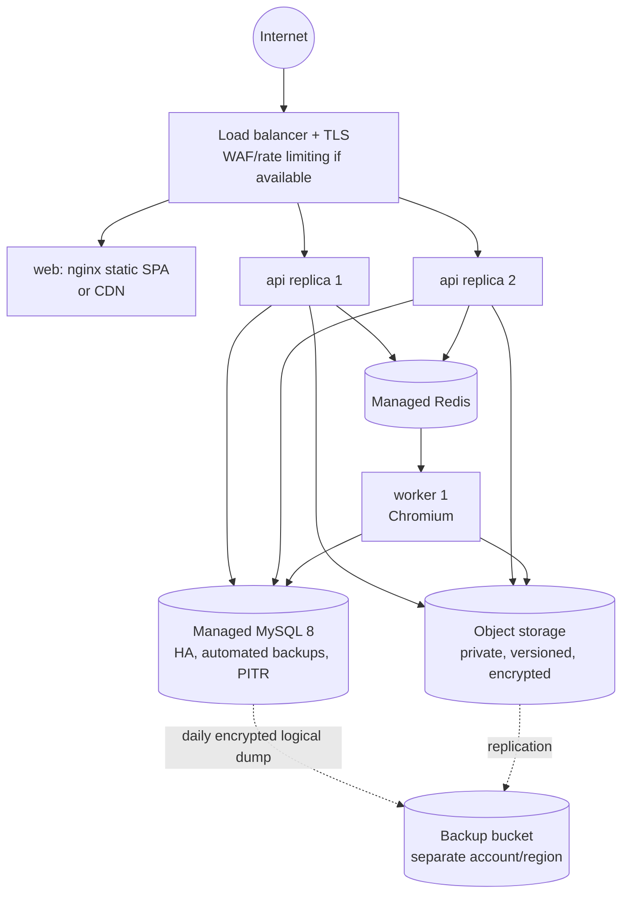

# 02 — System Architecture

## 1. Architectural style

**Modular monolith** with a separate background worker process, exposed through a versioned REST API and consumed by a React single-page application.

Why not microservices: one team, one database, strong transactional needs (finance) and a moderate scale target. A modular monolith with strict module boundaries gives most of the benefits (clear ownership, testability) without the operational cost. Modules talk to each other through service interfaces and domain events, never by reaching into another module's tables, so a module can be split out later if needed.

## 2. Technology stack

| Layer | Choice | Notes |
|-------|--------|-------|
| Runtime | Node.js 22 LTS | Active LTS at project start |
| Language | TypeScript 5.x, `strict: true` | Shared across all packages |
| API framework | Express.js 5 | Approved |
| Validation | Zod | Schemas live in `packages/shared` and are used by both API and web forms. OpenAPI is generated from them. |
| ORM / migrations | Prisma (MySQL provider) | Approved. `prisma migrate` for versioned migrations. |
| Database | MySQL 8.0+ (InnoDB, `utf8mb4`, `utf8mb4_0900_ai_ci`) | Approved |
| Cache / queue | Redis 7 + BullMQ | **[PROPOSED]** For PDF batches, imports, notifications, rate limiting (D-04) |
| Object storage | S3-compatible API (MinIO for local development) | Logos, photos, documents, generated PDFs, import files. Works with AWS S3, GCS (interop), Azure (via gateway), Cloudflare R2, DigitalOcean Spaces, etc. |
| Password hashing | Argon2id (`argon2` package) | See 06 — Security |
| PDF | HTML/CSS templates → headless Chromium (Playwright) | **[PROPOSED]** (D-05) |
| Excel | SheetJS CE (parse .xlsx/.xls/.csv) + ExcelJS (styled .xlsx output) | **[PROPOSED]** (D-06) |
| Frontend build | Vite | |
| UI | React 19 + TypeScript + Tailwind CSS 4 | Approved |
| Routing | React Router | |
| Server state | TanStack Query | Caching, retries, offline-tolerant mutations |
| Forms | React Hook Form + Zod resolver | Same schemas as the API |
| Tables | TanStack Table | Headless, accessible markup under our control |
| Charts | Recharts (web); server-rendered SVG in PDFs | |
| i18n | i18next + react-i18next (web), shared message catalogues for API errors and PDFs | |
| UI primitives | Radix UI primitives styled with Tailwind | Accessible dialogs, menus, popovers without a heavy component library |
| Testing | Vitest (unit), Supertest + Testcontainers MySQL (API integration), Playwright (E2E) | |
| Logging / metrics | Pino (JSON logs), OpenTelemetry-compatible metrics and traces | Provider-neutral |
| Package manager | pnpm workspaces | **[PROPOSED]** (D-02) |
| CI | GitHub Actions | Lint, typecheck, test, build, migration check, dependency audit |
| Containers | Docker (multi-stage builds) | Same images in every environment |

Dependency policy: every new runtime dependency needs a stated reason, an actively maintained upstream and a permissive licence, and must pass `pnpm audit` in CI.

## 3. Logical architecture



### 3.1 Request lifecycle (API)
1. **Edge:** TLS, request size limits, security headers.
2. **Request context:** generate a `requestId`; start an `AsyncLocalStorage` context.
3. **Authentication:** verify the access token (JWT). Load `userId`, `schoolId`, role and permission version.
4. **Tenant context:** bind `schoolId` into the request context. Platform-scope routes (`/api/v1/platform/*`) require Super Admin and have no tenant context unless support mode is active.
5. **Authorization:** route-level `requirePermission('students.update')`, then service-level scope checks (e.g. "teacher is assigned to this section").
6. **Validation:** Zod parse of params, query and body. Unknown fields are rejected.
7. **Service / domain logic:** transactions, invariants, domain events.
8. **Repository (Prisma, tenant-scoped client):** `school_id` is injected automatically into every query on tenant tables.
9. **Audit:** sensitive operations write an audit record in the same transaction.
10. **Response:** a consistent JSON envelope, or an RFC 9457 problem-details error. Errors are localized via message keys.

### 3.2 Backend module layout (per module)
```
apps/api/src/modules/students/
  students.routes.ts        # Express router: paths, permission guards, validation
  students.controller.ts    # HTTP ↔ service mapping only
  students.service.ts       # business rules, transactions
  students.repository.ts    # Prisma queries (tenant-scoped client only)
  students.events.ts        # domain events emitted/handled
  students.mapper.ts        # DB model → API DTO (strips internal fields)
  __tests__/                # unit + integration tests
```
Rules: controllers never call Prisma directly. Services never import another module's repository; they call that module's service. All cross-cutting code (auth, tenancy, audit, errors, pagination) lives in `apps/api/src/core`.

## 4. Repository structure (monorepo) **[PROPOSED]**

```
gol-khatumo/
├─ apps/
│  ├─ api/                     # Express REST API (+ worker entry point)
│  │  ├─ src/
│  │  │  ├─ core/              # config, auth, tenancy, rbac, audit, errors, logging, http
│  │  │  ├─ modules/           # one folder per domain module
│  │  │  ├─ jobs/              # BullMQ processors (pdf, import, export, notify, schedule)
│  │  │  ├─ pdf/               # PDF templates, layout partials, fonts
│  │  │  ├─ excel/             # template definitions, parsers, validators
│  │  │  ├─ server.ts          # HTTP entry point
│  │  │  └─ worker.ts          # worker entry point (same codebase, different process)
│  │  ├─ prisma/
│  │  │  ├─ schema.prisma
│  │  │  ├─ migrations/
│  │  │  └─ seed/              # permissions catalogue, system roles, demo school (dev only)
│  │  └─ test/                 # integration test harness (Testcontainers)
│  └─ web/                     # React SPA
│     └─ src/
│        ├─ app/               # providers, router, layout shell
│        ├─ components/ui/     # design-system primitives (Button, Input, DataTable, Modal…)
│        ├─ features/          # one folder per module (pages, hooks, components)
│        ├─ lib/               # api client, auth, permissions, formatting
│        └─ locales/{so,en}/   # translation JSON
├─ packages/
│  └─ shared/                  # Zod schemas, DTO types, enums, permission keys, i18n error keys
├─ docs/                       # this documentation set, ADRs, API docs, runbooks
├─ infra/
│  ├─ docker/                  # Dockerfiles, docker-compose for local dev
│  └─ deploy/                  # provider-neutral deployment manifests (added in Phase 10)
├─ .github/workflows/          # CI
└─ package.json / pnpm-workspace.yaml / tsconfig.base.json
```

The brief's "separate frontend, backend, database and shared types" maps to `apps/web`, `apps/api`, `apps/api/prisma` and `packages/shared`. Prisma stays inside the API because only the API and worker access the database. The frontend can never import it.

## 5. REST API conventions

| Topic | Convention |
|-------|-----------|
| Base path | `/api/v1` (tenant routes) and `/api/v1/platform` (Super Admin routes) |
| Resources | Plural nouns, kebab-case: `/students`, `/fee-structures`, `/exams/{id}/papers` |
| Methods | `GET` list/read, `POST` create/action, `PATCH` partial update, `DELETE` only where deletion is allowed. State transitions are explicit actions: `POST /exams/{id}/publish`, `POST /payments/{id}/void`. |
| IDs | Opaque string IDs (UUIDv7). Never sequential IDs that leak counts. |
| Pagination | `?page=1&pageSize=25` (max 100) → `{ data: [...], meta: { page, pageSize, total } }`. Cursor pagination for audit logs. |
| Filtering / sorting | `?status=ACTIVE&sectionId=…&q=amina&sort=-createdAt` with an allow-list per endpoint |
| Errors | RFC 9457 `application/problem+json`: `{ type, title, status, code, detail, errors: [{ path, code, message }] }`. `code` is a stable key such as `FEE_STUDENT_IS_FREE`. Messages are localized by `Accept-Language`. |
| Idempotency | `Idempotency-Key` header required on `POST /payments`, `POST /fee-charges/generate` and import commits |
| Concurrency | Optimistic locking via a `version` field on mutable aggregates (returned as `ETag`, sent back as `If-Match`) |
| Dates | ISO 8601. Dates without time (`2026-11-23`) for attendance, DOB and due dates. UTC timestamps for events. Display converted to the school's time zone. |
| Money | Decimal strings with 2 decimal places (`"125.50"`), never floats. The currency is USD in v1 (C-16), read from the school record so a later release can add others. |
| Files | `multipart/form-data` upload → file record ID. Downloads via short-lived signed URLs. |
| Long tasks | `202 Accepted` + `{ jobId }` → `GET /jobs/{jobId}` for status, progress and result URL |
| Documentation | OpenAPI 3.1 generated from Zod schemas (`@asteasolutions/zod-to-openapi`), served with Swagger UI in non-production |

Indicative endpoint groups (full catalogue produced in Phase 2 and extended per phase):

```
POST   /api/v1/auth/login | /auth/refresh | /auth/logout | /auth/change-password
GET    /api/v1/me                                  (profile, permissions, school, language)
---- platform (Super Admin) ----
GET|POST       /api/v1/platform/schools
GET|PATCH      /api/v1/platform/schools/{id}
POST           /api/v1/platform/schools/{id}/suspend | /reactivate | /support-session
GET            /api/v1/platform/audit-logs
---- tenant ----
GET|POST       /academic-years       POST /academic-years/{id}/set-current | /close
GET|PATCH      /academic-years/{id}/terms   (Mid Term, Final Term: created with the year; dates editable)
GET|POST       /grade-levels  /sections  /subjects  /teaching-assignments
GET|POST       /students             GET|PATCH /students/{id}   POST /students/{id}/transfer | /change-status
GET|POST       /guardians            POST /students/{id}/guardians
GET|POST       /staff                /staff-attendance
GET|PUT        /sections/{id}/attendance/{date}
GET|POST       /timetables/{sectionId}  /period-definitions
GET|POST       /exams   /exams/{id}/papers   PUT /exam-papers/{id}/marks   POST /exams/{id}/lock | /publish | /unlock
GET            /results/sections/{id}?examId=…   /rankings?…
POST           /report-cards/generate  (→ job)
GET|POST       /fee-categories  /fee-structures   POST /fee-charges/generate (preview|commit)
GET|POST       /students/{id}/billing-profile   (FEE_PAYING | FREE)
GET|POST       /payments   GET /payments/{id}/receipt.pdf   POST /payments/{id}/void
GET            /balances?sectionId=…&status=PARTIAL
GET|POST       /income  /expenses  /finance-accounts
GET|POST       /library/books  /library/copies  /library/loans
GET|POST       /inventory/items  /inventory/movements
GET|POST       /transport/vehicles  /transport/routes  /transport/assignments
GET|POST       /notifications  /announcements
GET            /reports/{reportKey}?format=json|pdf|xlsx
GET            /imports/templates/{type}   POST /imports/{type}/validate   POST /imports/{jobId}/commit   GET /imports/{jobId}/errors.xlsx
GET|POST|PATCH /users  /roles   GET /audit-logs
GET            /jobs/{id}   GET /health  GET /ready
```

## 6. Multi-school tenancy strategy

### 6.1 Options considered
| Model | Isolation | Cost / ops | Cross-school admin | Verdict |
|-------|-----------|-----------|--------------------|---------|
| A. Database per school | Strongest | High: N databases, N migrations, N backups | Hard | Overkill at this scale |
| B. Schema per school | Strong | Medium–high. In MySQL a schema is a database, so the same problems as A. | Hard | Rejected |
| **C. Shared database, `school_id` discriminator** | Good when enforced in layers | Low: one schema, one migration path | Easy | **[PROPOSED] (D-01)** |

Model C is the standard choice for SaaS at this scale. Its risk is a developer forgetting a filter. The mitigation is to make forgetting impossible or detectable, in five layers.

### 6.2 Isolation layers (defence in depth)
1. **Schema:** every school-owned table has `school_id CHAR(36) NOT NULL`, indexed as the leading column of its composite indexes. Natural keys are unique per school, e.g. `UNIQUE (school_id, admission_no)`.
2. **Database referential integrity:** important child tables reference their parents with **composite foreign keys `(school_id, parent_id)` → parent `(school_id, id)`**. The database itself then rejects, for example, a mark whose student belongs to another school, even if application code has a bug. (Prisma supports relations on compound unique keys. This is confirmed in a Phase 2 spike.)
3. **Tenant-scoped data access:** repositories receive a Prisma client wrapped by a **Prisma Client extension** that reads `schoolId` from the request context (`AsyncLocalStorage`) and
   - adds `where: { schoolId }` to every `find*`, `count`, `aggregate`, `groupBy`, `update*` and `delete*` on tenant models;
   - sets `data.schoolId` on every `create*`/`upsert` and rejects any attempt to set a different one;
   - throws if a tenant model is queried with no tenant context.
   Raw SQL (`$queryRaw`) is banned by lint rule except in a reviewed `reporting` folder, and those queries must take `schoolId` as their first bound parameter.
4. **Authorization:** `schoolId` always comes from the verified session, **never from the request body, URL or headers**. A record ID from another school therefore returns `404` (not `403`), so attackers cannot confirm that it exists.
5. **Tests:** an automated isolation suite seeds two schools and, for every registered route, asserts that a user of school A gets 404 or an empty list for school B's resources. A new route without isolation coverage fails CI.

Also:
- **Object storage:** keys are prefixed `schools/{schoolId}/{category}/{uuid}.{ext}`. Downloads go through an API endpoint that authorises first and then issues a signed URL valid for 5 minutes.
- **Cache and queue:** Redis keys and job payloads always include `schoolId`. Workers re-establish the tenant context from the job before touching data.
- **Logs:** every log line carries `schoolId` and `requestId`, for forensics.

### 6.3 Platform scope vs school scope
- Platform tables (`schools`, `platform_settings`, `permissions`, system role templates) have no `school_id`.
- Users carry a `school_id`, which is `NULL` only for platform users (Super Admins).
- **Super Admin support mode [PROPOSED]:** a Super Admin cannot browse school data by default. To troubleshoot, they start a time-limited (e.g. 60 minutes) **support session** for one school with a stated reason. It is read-only by default and audit-logged, and is visible to that school's admins in the audit log (Q-P1).

### 6.4 Tenant resolution
The tenant comes from the authenticated user (JWT claim `sid`, cross-checked against the database on refresh). Subdomains per school (`golkhatumo.gksms.app`) are optional branding for later. They would preselect the school's logo on the login page but are never trusted for authorization.

### 6.5 Growth path
If one school grows very large, or a school needs contractual data residency, the same schema can be deployed as a dedicated database for that school, with a tenant → connection routing table. The schema is designed so that this needs no data-model changes.

## 7. Excel architecture



Design points:
- **Template registry:** each import type (students, guardians, staff, fee structures, opening balances, exam marks) is declared once: columns, localized header names (Somali/English, both accepted on upload), Zod row schema, reference resolvers (e.g. section name → section ID) and a duplicate key. Templates, validation, preview and error reports are all generated from that single definition, which avoids duplicated code.
- **Student template:** the columns are specified in FR-XLS-10: four mandatory name parts (C-12) and mandatory parent/guardian full name and phone (C-13), validated like the registration form.
- **Parsing:** SheetJS reads `.xlsx`, `.xls` and `.csv`. Header row detection matches Somali or English headers case-insensitively. Dates are normalized from Excel serial numbers and text formats. Phone numbers are normalized to E.164 (e.g. `+252…`).
- **Safety:** max file size 5 MB, max 5,000 rows, magic-byte check, no macros (`.xlsm` rejected), formula cells read as values only. CSV export escapes cells starting with `= + - @ \t \r` to prevent **formula injection**.
- **Validation stages:** (1) structural (headers present), (2) row schema (types, required, enums), (3) referential (section exists in the current year), (4) business rules (capacity, FREE students cannot have tuition opening balances, C-17), (5) duplicates within the file and against the database.
- **Commit:** all-or-nothing by default. For very large files, batches of 500 inside a job, with a compensating rollback of that import's records if a batch fails.
- **Exports:** run synchronously for ≤ 5,000 rows and in the background above that. They apply the same filters and permission checks as the list endpoint. Columns containing financial data are excluded for roles without finance permission.

## 8. PDF architecture

### 8.1 Engine choice **[PROPOSED] (D-05)**
| Option | Pros | Cons |
|--------|------|------|
| **HTML/CSS → headless Chromium (Playwright)** | Pixel-precise professional layouts, CSS paged media (`@page`, running headers, page counters), SVG charts, easy bilingual typography, same skills as the frontend | Heavier container (~400 MB). Needs a worker pool. |
| pdfmake / PDFKit (programmatic) | Light, fast, no browser | Layouts are verbose to build and maintain. Tables across pages and charts take more effort. |
| Client-side generation (jsPDF) | No server cost | Inconsistent output, exposes full data to the client, weak for bulk jobs |

Recommendation: **Chromium rendering in the worker tier.** Single small documents (a receipt) can be rendered synchronously by a warm worker browser through the queue with a short timeout, so the API containers stay light.

### 8.2 Pipeline
```
Report request → permission check → data query (tenant-scoped, read-only)
  → view model (localized labels, formatted numbers/dates/currency, amount-in-words)
  → HTML template (shared layout: header/footer/signatures) + embedded fonts + inline SVG charts
  → Chromium page.pdf({ format: 'A4', printBackground: true, displayHeaderFooter, margins })
  → stream to client (single doc)  OR  store in object storage + job result (bulk / merged)
```
- **Layout kit:** reusable partials for the school header (logo, bilingual name, address, phone, email, registration number), report title block (title, academic year, term label "Mid Term" or "Final Term" where the report is term-based, filters applied, generated on/by), data tables (repeated `<thead>` on each page, zebra rows, totals row), KPI summary, chart slot, signature block (prepared by / checked by / principal, plus stamp), and footer ("Page X of Y", document code, generation timestamp).
- **Fonts:** open-licence fonts with full Latin Extended coverage (e.g. **Noto Sans** for body, **Noto Serif** optional for headings), bundled in the image and embedded in the PDF, so nothing depends on fonts installed on the server.
- **Charts:** rendered server-side to SVG (the same chart specs as the web app, using a small SVG chart helper). No client-side JavaScript runs in the PDF.
- **Preview / download / print:** the web app fetches the PDF as a blob and shows it in an `<iframe>` viewer (desktop) or opens it in the device's native viewer (mobile), with buttons for **Download** (`Content-Disposition: attachment`) and **Print** (iframe `print()`).
- **Security:** templates are rendered with auto-escaping. Chromium runs with no network access (requests are intercepted; only embedded `data:` assets are allowed), JavaScript disabled for template content, and a per-render timeout.
- **Bulk:** batch report cards are processed in chunks, merged into one PDF (`pdf-lib`) or zipped per student, stored for 7 days, then deleted.
- **Official documents:** receipts and report cards can embed a verification code and QR (FR-PDF-07, could-have).

### 8.3 Standard PDF catalogue (v1)
Receipt · Student fee statement · Outstanding balances by class · Class financial summary · Free student register · Daily cash report · Income/expense report · Mid Term report card · Final Term report card (Mid Term and Final Term shown separately, no combined result) · Mark sheet / broadsheet (per term) · Ranking list (Mid Term / Final Term) · Section roster · Parent/guardian contact list · Attendance register (monthly) and term attendance summary · Staff attendance report · Timetable (section/teacher) · Exam schedule (per term) · Library overdue list · Inventory stock report · Transport route roster · Student profile.

## 9. Localization (Somali / English)

- **UI strings:** i18next JSON namespaces per feature in `apps/web/src/locales/{so,en}`. Missing keys fail CI. Somali translations are reviewed by a native speaker (Q-G6).
- **API messages:** error responses carry a stable `code` and a localized `message` resolved from `Accept-Language`, falling back to the school default.
- **Data in two languages:** reference data that appears on official documents (school name, term labels, subject names, fee categories, grade remarks) has `name_so` and `name_en` columns. The term labels are seeded as the official **"Mid Term"** and **"Final Term"** in both columns until the school confirms Somali wording (Q-AY1). Personal names are stored as entered (single value).
- **Formatting:** dates use `DD/MM/YYYY` by default (configurable). Numbers and currency are formatted via `Intl` with explicit settings (Somali locale data in browsers is incomplete, so the formats are pinned, not left to the browser). Amount in words is implemented for both languages.
- **User preference:** stored per user, switchable from the top bar, applied immediately without a reload.

## 10. Cloud deployment strategy (provider-independent)

### 10.1 Principles
- Everything runs as **OCI containers**: `api`, `worker`, `web` (static files served by nginx or a CDN).
- Only **commodity managed services** are needed, and every major cloud has them: managed MySQL 8, managed Redis, S3-compatible object storage, a container runtime, a load balancer with TLS, and a secrets store.
- Configuration comes only from environment variables and secrets injection (twelve-factor).
- Infrastructure as code (Terraform/OpenTofu) is written once a provider is selected, in Phase 10.

### 10.2 Environments
| Environment | Purpose | Data |
|-------------|---------|------|
| Local | Developer machines via `docker compose` (MySQL, Redis, MinIO, Mailpit) | Seeded demo data |
| CI | Ephemeral Testcontainers per test run | Synthetic |
| Staging | Production-like; UAT by school staff | Anonymised or synthetic. **Never** real student data unless anonymised. |
| Production | Live | Real |

### 10.3 Production topology (initial)


Indicative sizing at launch (1–10 schools): 2 × API (1 vCPU / 1 GB), 1 × worker (2 vCPU / 2 GB), MySQL 2 vCPU / 4 GB with HA standby, small Redis. Scale API and worker replicas horizontally on CPU and queue depth.

### 10.4 Release process
- Trunk-based development with short-lived feature branches and pull requests. CI must be green and a review approved before merge.
- CI pipeline: install → lint → typecheck → unit tests → integration tests (MySQL container) → E2E smoke → build images → vulnerability scan → push to registry.
- Deploys: staging automatically on merge, production by manual approval. Database migrations run as a separate pre-deploy job (`prisma migrate deploy`) and must be **backward compatible** (expand → migrate → contract) so rolling deploys never break.
- Rollback: redeploy the previous image. Migrations are additive within a release, so no down-migration is needed for rollback.

### 10.5 Observability
Structured logs to the provider's log service, metrics (request rate, latency, errors, queue depth, job failures, DB connections), uptime checks on `/health` and `/ready`, and alerts to the operations contact. Error tracking (e.g. self-hosted or SaaS Sentry-compatible) with PII scrubbing.
