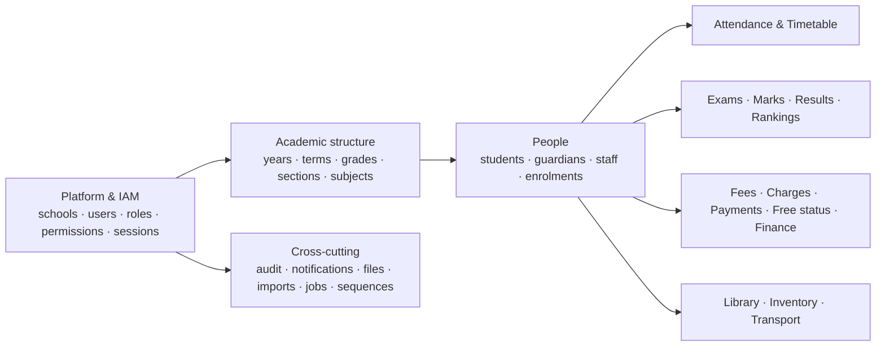
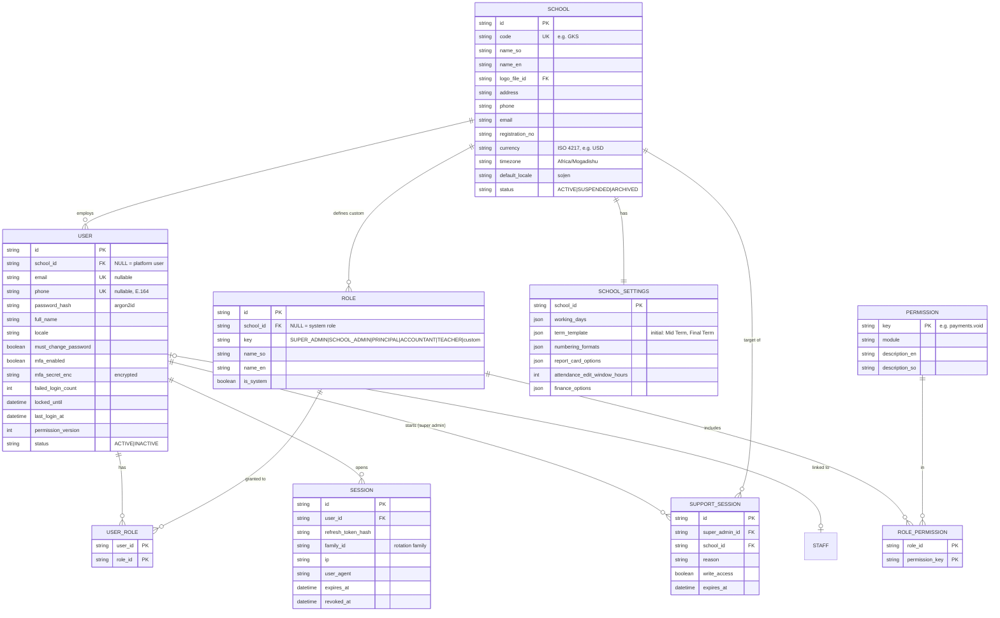
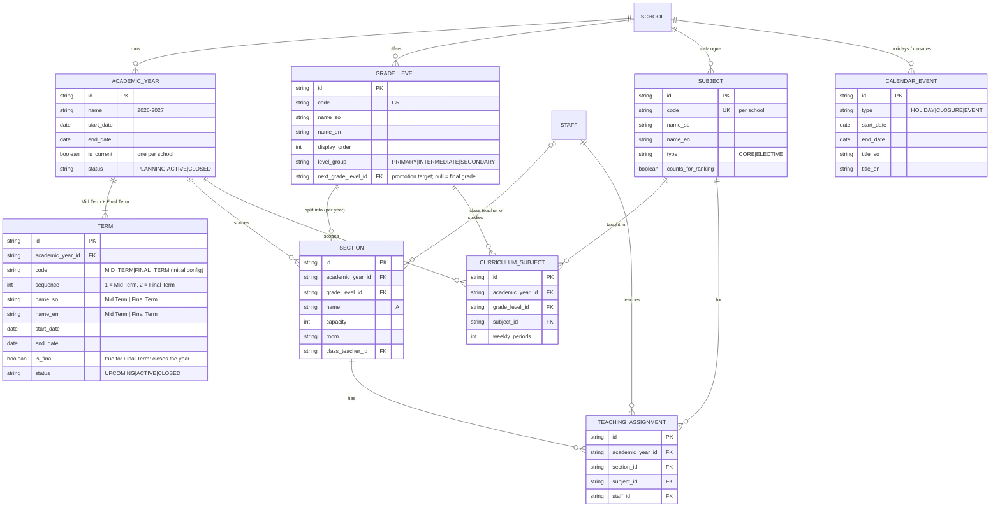
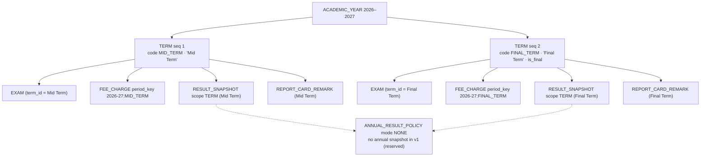
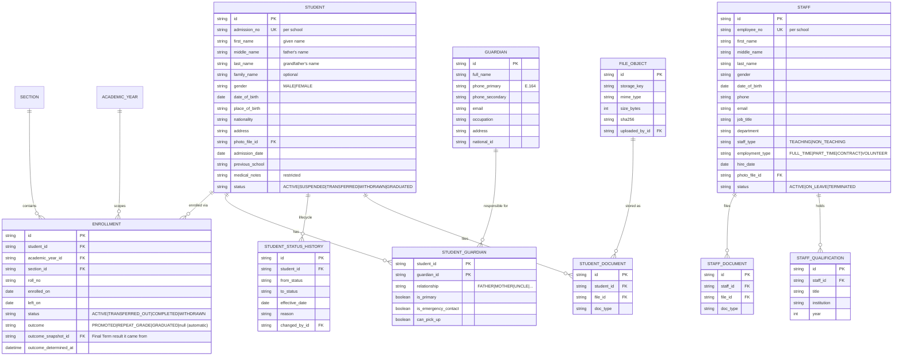
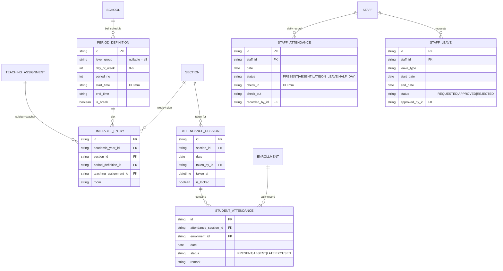
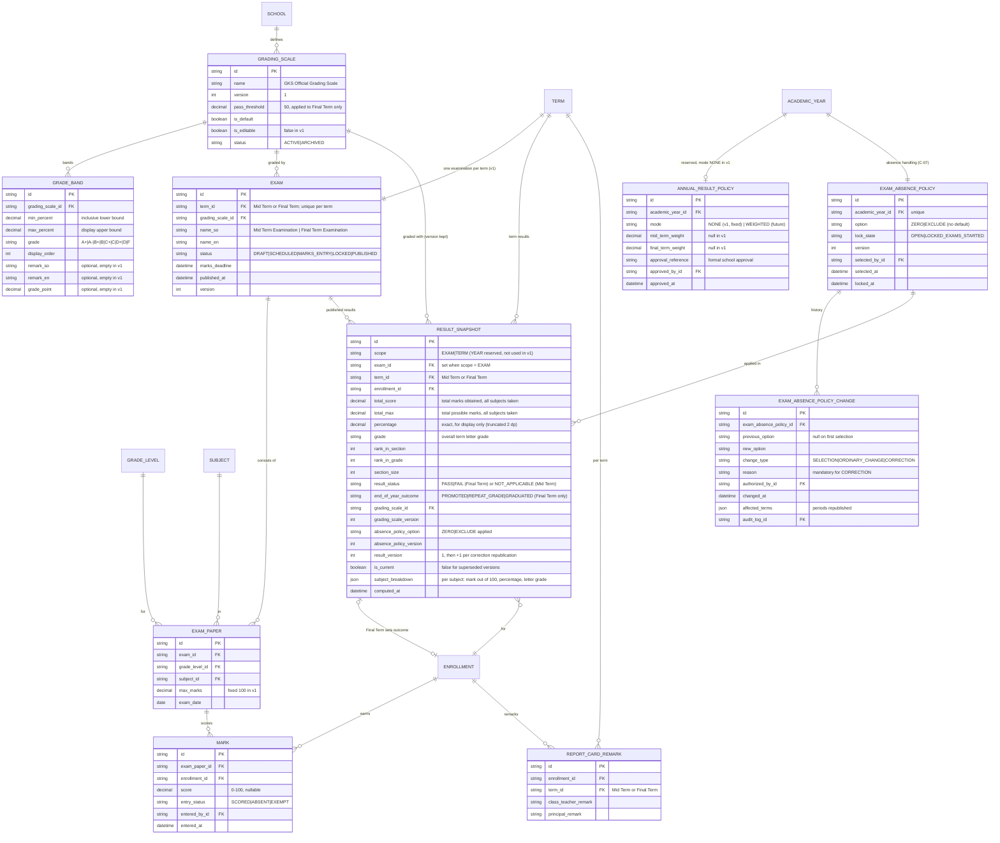
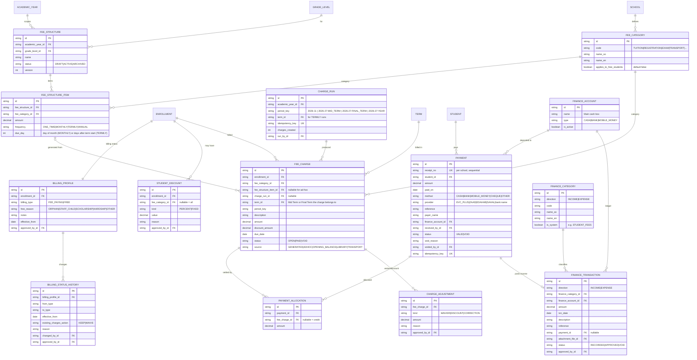
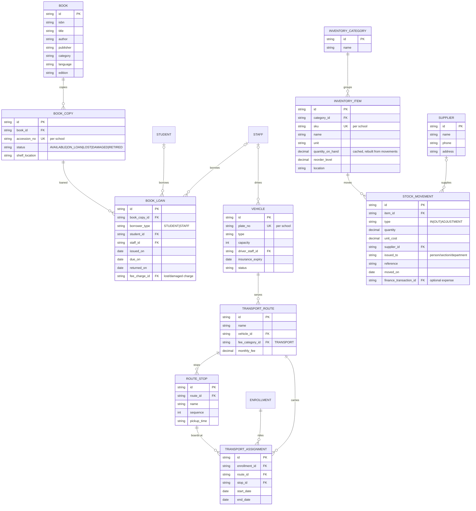
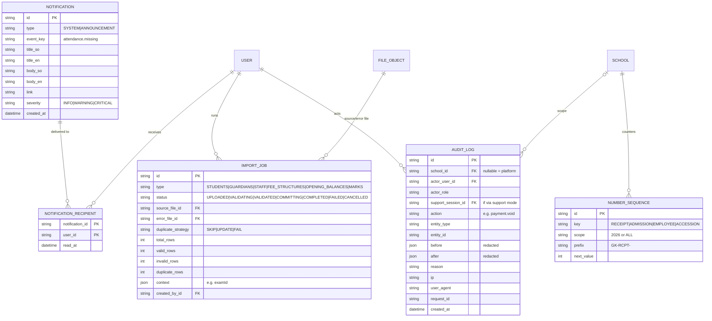

# 03 — Database Design & ERD

## 1. Conventions

| Topic | Convention |
|-------|-----------|
| Engine / charset | MySQL 8, InnoDB, `utf8mb4` / `utf8mb4_0900_ai_ci` (case- and accent-insensitive search on names) |
| Naming | Tables `snake_case` plural (`students`). Prisma models `PascalCase` singular, mapped with `@@map`. Columns `snake_case` via `@map`. |
| Primary keys | `id CHAR(36)`, UUIDv7, generated by the application. Time-ordered, so it indexes well, and it does not reveal record counts. |
| Tenant key | `school_id CHAR(36) NOT NULL` on every school-owned table, leading column in composite indexes. Each tenant table also has `UNIQUE (school_id, id)` so that it can be the target of composite FKs. |
| Timestamps | `created_at`, `updated_at` as `DATETIME(3)` in UTC. `created_by_id` / `updated_by_id` on business records. |
| Soft delete | Master data (students, staff, books, items…) uses a `status` and/or `archived_at`. **Financial and audit records are never deleted**: they are voided with a reason. |
| Money | `DECIMAL(12,2)`. Never FLOAT. Currency is stored on `schools`. |
| Marks | `DECIMAL(6,2)` |
| Enums | Prisma enums (MySQL `ENUM`) for stable sets. Lookup tables for school-configurable sets (fee categories, expense categories). |
| Bilingual reference data | `name_so`, `name_en` columns |
| Optimistic locking | `version INT` on aggregates edited by several users (exams, fee structures, timetables) |
| JSON | Only for unstructured settings and audit snapshots, never for data that is queried or reported on |

## 2. Domain overview

The ERDs below show the main entities and key columns. Every entity except platform-level ones also carries `school_id`, `created_at` and `updated_at`; the diagrams omit them for readability unless they matter. The full column list is finalised in `schema.prisma` in Phase 2.

## 3. Platform, identity & access

## 4. Academic structure

### 4.1 Term structure (two terms: Mid Term and Final Term)

Gol Khatumo School uses **terms, not semesters**: exactly two per academic year (01 — Requirements §1.6).

Constraints and rules:
- `UNIQUE (school_id, academic_year_id, sequence)` and `UNIQUE (school_id, academic_year_id, code)` on `term`.
- Term dates must fall inside the academic year and must not overlap (service validation plus tests). Sequence 1 = Mid Term, sequence 2 = Final Term.
- **Initial configuration (seed / school onboarding):** every academic year created for Gol Khatumo School gets exactly two terms, `MID_TERM` ("Mid Term") and `FINAL_TERM` ("Final Term", `is_final = true`). A school setting `term_template` holds this two-term template, and new years copy it. Terms are data, not hard-coded, so the structure stays configurable for future years, but the service only allows terms defined in the school's template. No third term and no semesters are created.
- A term is the parent of: exams (`exam.term_id`), termly fee charges (`fee_charge.term_id`, `period_key`), term result snapshots and report card remarks. Attendance records are linked to a term by date range; the term attendance summary is calculated from attendance dates within the term.
- Mid Term and Final Term results are independent, each out of 100% (Requirements §1.7). Closing the **Final Term** (when its results are published) enables year-end rollover. It does **not** produce an annual result.

## 5. People: students, guardians, staff, enrolment

**Invariant:** `UNIQUE (school_id, student_id, academic_year_id)` on `enrollment`, where status is not `TRANSFERRED_OUT`. A section transfer closes the old enrolment and opens a new one (enforced in the service, with a partial-uniqueness surrogate column if needed). Attendance, marks and charges reference the **enrolment**, so history follows the student correctly across sections and years.

## 6. Timetable & attendance

Uniqueness: `(school_id, section_id, date)` on attendance sessions; `(school_id, enrollment_id, date)` on student attendance; `(school_id, staff_id, date)` on staff attendance. Timetable conflict rules are enforced in the service and backed by `UNIQUE (school_id, section_id, period_definition_id)` and a teacher-slot uniqueness check.

## 7. Examinations, marks, results & ranking

Rules:
- `UNIQUE (school_id, exam_paper_id, enrollment_id)` on marks.
- **One examination per term (v1):** `UNIQUE (school_id, term_id)` on `exam`; `UNIQUE (school_id, exam_id, grade_level_id, subject_id)` on `exam_paper`; `max_marks = 100` (check constraint); `0 ≤ score ≤ 100` (check constraint).
- **Official grading scale (seeded, C-03):** `grading_scale` "GKS Official Grading Scale" v1, `pass_threshold = 50`, `is_editable = false`, with `grade_band` rows (min → grade): 91 A+, 85 A-, 80 B+, 75 B, 70 C+, 65 C, 60 D+, 50 D, 0 F. The grade is the band with the highest `min_percent` ≤ the percentage (see Requirements §1.8 GS-3 and Q-E8 for non-whole percentages).
- **Overall percentage (C-05):** `total_score` = sum of marks obtained across all subjects taken in the term; `total_max` = sum of possible marks across those subjects (100 each). EXEMPT subjects are excluded from both. ABSENT is handled by the academic year's `exam_absence_policy` (C-07): **ZERO** → 0 out of 100, included in both totals; **EXCLUDE** → left out of both totals.
- **Result status (C-05):** Final Term `result_status = PASS` when `total_score × 100 ≥ pass_threshold × total_max`, else `FAIL`. This compares the exact totals, so there is no rounding. Individual subject grades never decide PASS/FAIL. For the Mid Term snapshot, `result_status = NOT_APPLICABLE`. Mid Term never affects the Final Term status or the outcome.
- **Grade from exact percentage:** the overall grade uses the same exact comparison against each band's `min_percent` (`total_score × 100 ≥ min_percent × total_max`). `percentage` is stored for display and reporting only and is never used for decisions.
- **End-of-year outcome (C-06), automatic:** when the Final Term exam is published, `end_of_year_outcome` is set on each Final Term snapshot: PASS → `PROMOTED` (or `GRADUATED` when the grade level has no `next_grade_level_id`, **[PROPOSED]** Q-E10); FAIL → `REPEAT_GRADE`. It is copied to `enrollment.outcome` with `outcome_snapshot_id`, by the system actor, with an audit entry. No approval step exists, and no API lets a user set or override `outcome`.
- **Corrections:** an outcome changes only if Final Term marks are corrected through the audited unlock → re-publish flow before rollover commits. After rollover, a correction also moves the next-year enrolment (same grade level ↔ next grade level), audit-logged.
- **Absence policy lock (C-07):** one `exam_absence_policy` row per academic year, with no default value. An exam cannot move to `MARKS_ENTRY` while the year's policy has no `option`. `lock_state` becomes `LOCKED_EXAMS_STARTED` when the first exam of the year enters `MARKS_ENTRY` or its first paper date arrives, whichever is earlier. After that, the ordinary settings endpoint rejects changes (`409 ABSENCE_POLICY_LOCKED`). A term whose exam is `PUBLISHED` is fully locked: its snapshots keep `absence_policy_option` and `absence_policy_version`.
- **Correction and republication:** the only path after the lock is the correction service (permission `exams.absence_policy.correct`). In one transaction it writes an `exam_absence_policy_change` (previous, new, reason, authorised user, date) and an audit entry, increments `version`, and moves the affected exams back to `LOCKED`. Republishing then writes new snapshots with `result_version + 1` and marks the previous ones `is_current = false`; they are never deleted. Outcomes are recalculated as described under Corrections above. No other code path writes snapshots of a published exam.
- Snapshots store `grading_scale_id` and `grading_scale_version`, so a future scale change never alters published grades.
- Every exam belongs to exactly one term (Mid Term or Final Term), and its paper dates must fall inside that term.
- Result levels in v1: **EXAM** → **TERM**. The Mid Term result and the Final Term result are each calculated independently on a 100% scale: every subject's term mark is out of 100 (`total_max` = 100 × counted subjects), and the grading scale is applied per term. Ranks are computed per exam and per term.
- **No YEAR (annual) snapshot is produced in v1.** The `YEAR` scope value and `annual_result_policy` are reserved for a possible future, formally approved annual calculation. In v1 the service rejects any policy mode other than `NONE`, and no code path combines Mid Term and Final Term or uses the Final Term result as an annual result.
- If an annual policy is approved in future, it applies only to academic years whose Final Term results are not yet published, and every change is audit-logged.
- Marks can be written only while `exam.status = MARKS_ENTRY`. The service checks this inside the transaction, together with the exam `version`.
- On publish, results and ranks are computed and written to `result_snapshot`. Report cards and rankings read **only** snapshots, so published results cannot drift. Unlocking a published exam invalidates its snapshots, and re-publishing recomputes them (audited).

## 8. Fees, payments, free students & finance

### 8.1 Financial invariants (enforced in services, verified by tests)
1. **Balance derivation:** `balance(enrollment) = Σ charge.amount − Σ charge.discount_amount − Σ adjustment.amount − Σ allocation.amount` over non-void charges and valid payments. There is **no stored "balance" column** that can drift. A per-enrolment summary may be cached for reports and is rebuilt from the ledger.
2. **Free students:** while `billing_profile.billing_type = FREE`, charge generation skips the enrolment, and creating any charge whose category has `applies_to_free_students = false` is rejected with `FEE_STUDENT_IS_FREE`. Free students therefore always have outstanding = 0 for those categories.
3. **Fee status** per enrolment and period: `FREE` if billing type is FREE; otherwise `PAID` / `PARTIAL` / `UNPAID` / `CREDIT`, derived from the balance (FR-BAL-02).
4. **Idempotent generation:** `UNIQUE (school_id, enrollment_id, fee_structure_item_id, period_key)` on generated charges, so a run repeated for the same period creates nothing new. TERMLY items produce exactly two charges per fee-paying enrolment per year: one for Mid Term and one for Final Term. MONTHLY charges carry the `term_id` of the term their month falls in, so balances can be reported per term.
5. **Allocation integrity:** `Σ allocations(payment) = payment.amount`; `Σ allocations(charge) ≤ charge net amount`. Both are checked in the same transaction with row locks (`SELECT … FOR UPDATE`).
6. **Immutability:** payments, allocations and charges are never updated in amount or deleted. Corrections use void + re-issue, or adjustments, all audit-logged.
7. **Receipt numbers** come from `number_sequence` with a row lock, inside the payment transaction: gapless and unique per school per year. A voided payment keeps its number.
8. **Income posting:** each valid payment creates exactly one `finance_transaction` (INCOME, category STUDENT_FEES). Voiding the payment voids that transaction.

## 9. Library, inventory & transport

`BOOK_LOAN` has a check constraint: exactly one of `student_id` / `staff_id` is set, matching `borrower_type`. MySQL 8.0.16+ enforces `CHECK` constraints.

## 10. Cross-cutting: audit, notifications, imports, jobs, sequences

- **Audit log** is append-only. The application's database user has only `INSERT` and `SELECT` on `audit_logs` (a separate grant, set up in Phase 10). Before/after snapshots pass through a redaction allow-list, so passwords, tokens and secrets are never logged.
- **Background job state** is held in BullMQ (Redis). Only business-relevant job records (imports, bulk PDF exports) are persisted in MySQL.

## 11. Indexing & performance notes
- Every tenant table: `INDEX (school_id, <most common filter>)`, e.g. `students (school_id, status, last_name)`, `fee_charges (school_id, enrollment_id, status)`, `payments (school_id, paid_on)`, `student_attendance (school_id, date)`.
- Name search: a generated column `search_name` (concatenated, lower-cased) with an index, which supports prefix search. FULLTEXT is used only if needed.
- Reporting queries (outstanding by class, collection by month) use covering indexes. Heavy reports can later read from a replica.
- Expected volume per school per year (3,000 students): attendance ≈ 3,000 × 200 days = 600k rows; marks ≈ 3,000 × 10 subjects × 2 exams (Mid Term, Final Term) = 60k rows; charges ≈ 3,000 × 12 months = 36k rows. Across 100 schools this is comfortable for a single MySQL primary with proper indexing. Attendance is the table to watch; partitioning by year is an option later.

## 12. Migration & seeding strategy
- `prisma migrate dev` locally; `prisma migrate deploy` in CI/CD. Migrations are committed and code-reviewed, and destructive changes follow expand → migrate → contract.
- **Seed (all environments):** permission catalogue, system roles with default permissions, system finance categories, and the **official grading scale** (C-03) for each school.
- **Seed (dev/staging only):** a demo school with synthetic students, staff and marks, for testing and UAT.
- **Data migration from existing records:** via the Excel import pipeline (students, guardians, staff, opening balances). No direct SQL loading of production data.
