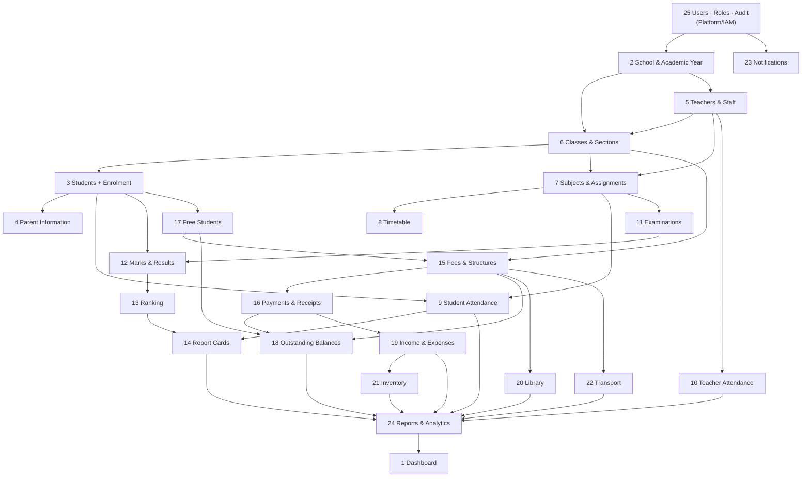
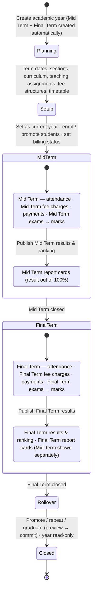

# 05 — Module Descriptions & Dependencies

## 1. Module catalogue

| # | Module | Purpose | Owns (main entities) | Depends on | Build phase |
|---|--------|---------|----------------------|-----------|-------------|
| 1 | **Dashboard** | Role-specific overview and KPIs; entry point after login | none (read models only) | All modules (read) | 3 (shell), extended each phase |
| 2 | **School & Academic Year** | Tenant profile, settings, academic years and their two terms (Mid Term, Final Term), calendar, rollover | School, SchoolSettings, AcademicYear, Term, CalendarEvent | Platform/IAM | 2–3 (school), 5 (years) |
| 3 | **Student Management** | Admission, profile, lifecycle, enrolment, transfers | Student, Enrollment, StudentStatusHistory, StudentDocument | 2, 6, 25 | 4 |
| 4 | **Parent Information** | Guardians and their links to students (no login) | Guardian, StudentGuardian | 3 | 4 |
| 5 | **Teacher & Staff** | Staff records, qualifications, documents, optional user link | Staff, StaffQualification, StaffDocument | 2, 25 | 4 |
| 6 | **Class & Section** | Grade levels and yearly sections, class teachers, rosters | GradeLevel, Section | 2, 5 | 4 (basic, needed for enrolment), 5 (full) |
| 7 | **Subject** | Subject catalogue, curriculum per grade, teaching assignments | Subject, CurriculumSubject, TeachingAssignment | 5, 6 | 5 |
| 8 | **Timetable** | Bell schedule and weekly timetables with conflict detection | PeriodDefinition, TimetableEntry | 6, 7 | 5 |
| 9 | **Student Attendance** | Daily attendance per section | AttendanceSession, StudentAttendance | 3, 6, 7 (teacher scope), 2 (calendar) | 5 |
| 10 | **Teacher Attendance** | Staff daily attendance and leave | StaffAttendance, StaffLeave | 5, 2 | 5 |
| 11 | **Examination** | Exam types, exams, papers, schedule, lifecycle, grading scales | ExamType, Exam, ExamPaper, GradingScale, GradeBand | 2, 6, 7 | 6 |
| 12 | **Marks & Results** | Mark entry and computation of totals, grades, pass/fail; Mid Term and Final Term results, each independent and out of 100% (no combined annual result in v1) | Mark, ResultSnapshot | 11, 3 | 6 |
| 13 | **Student Ranking** | Section and grade ranks per exam and per term (Mid Term, Final Term), top-N lists | (part of ResultSnapshot) | 12 | 6 |
| 14 | **Report Cards** | Official Mid Term and Final Term report card PDFs with remarks; both term results shown separately | ReportCardRemark | 12, 13, 9 (attendance summary), PDF engine | 6 (+ PDF polish in 9) |
| 15 | **Fees & Fee Structures** | Fee categories, structures per grade/year, charge generation, discounts, waivers | FeeCategory, FeeStructure, FeeStructureItem, ChargeRun, FeeCharge, StudentDiscount, ChargeAdjustment | 2, 3, 6, 17 | 7 |
| 16 | **Payments & Receipts** | Payments, allocation, receipts, voids, refunds, daily cash | Payment, PaymentAllocation, NumberSequence | 15, 19 (posting) | 7 |
| 17 | **Free Student Management** | FEE_PAYING/FREE billing status with approval and history | BillingProfile, BillingStatusHistory | 3 | 7 |
| 18 | **Outstanding Balances** | Derived balances, fee status, aging, class financial reports | none (read models from ledger) | 15, 16, 17 | 7 |
| 19 | **Income & Expenses** | Accounts, categories, other income, expenses, approvals, P&L | FinanceAccount, FinanceCategory, FinanceTransaction | 2, 16 | 7 |
| 20 | **Library** | Catalogue, copies, circulation, overdue, lost-book charges | Book, BookCopy, BookLoan | 3, 5, 15 (charges) | 8 |
| 21 | **Inventory** | Items, stock movements, suppliers, low-stock alerts | InventoryCategory, InventoryItem, StockMovement, Supplier | 2, 19 (optional expense) | 8 |
| 22 | **Transport** | Vehicles, routes, stops, student assignments, transport fees | Vehicle, TransportRoute, RouteStop, TransportAssignment | 3, 5, 15 | 8 |
| 23 | **Notifications** | In-app notifications, announcements, channel abstraction | Notification, NotificationRecipient | 25 (users) | 3 (core), events added per phase, 8 (full) |
| 24 | **Reports & Analytics** | Report centre, PDF/Excel outputs, charts, analytics | none (read models) | All | 9 (plus per-module reports delivered earlier) |
| 25 | **User Management & Audit** | Users, roles, permissions, sessions, audit log | User, Role, Permission, UserRole, Session, AuditLog, SupportSession | Platform | 2 (schema), 3 (features) |
| — | *Import/Export engine* (cross-cutting) | Templates, validation, preview, error reports, exports | ImportJob, FileObject | 3, 5, 12, 15 | 9 (engine). Phase 4/6/7 include basic export. |
| — | *PDF engine* (cross-cutting) | Layout kit, templates, rendering worker | — | All reporting modules | 7 (receipt first), 9 (full catalogue) |

## 2. Dependency graph

## 3. Key cross-module relationships

1. **Enrolment is the hub.** Attendance, marks, results, billing profile, charges and transport assignments all reference `enrollment` (student × year × section), not the student directly. This keeps every year's history correct after promotions and transfers.
2. **Teaching assignment drives teacher scope.** The Teacher role's access to attendance, marks, results and report cards is computed from `teaching_assignment` and `section.class_teacher_id` for the current academic year.
3. **Free status gates the fee engine.** The fee module asks the free-student module "is this enrolment billable for category X?" before creating any charge. Balances and reports read the same billing profile to label students FREE.
4. **Payments post to finance.** Recording a payment creates an income transaction in the same database transaction. The income/expense module never creates student-fee income by hand.
5. **Library and transport bill through fees.** Lost books and transport create `fee_charge` rows (sources `LIBRARY`, `TRANSPORT`), so there is one ledger and one balance per student.
6. **Exams publish snapshots.** Ranking and report cards read result snapshots, never live marks.
7. **Domain events drive notifications.** Modules emit events (`attendance.missing`, `exam.published`, `payment.voided`, `inventory.low_stock`, `library.overdue`, `import.completed`) and the notification module subscribes. Modules do not call each other for notifications.
8. **The term is the time axis of the year.** Each academic year has two terms, Mid Term and Final Term. Exams belong to a term; termly fees are charged per term; attendance, results, rankings and report cards are summarised per term; Mid Term and Final Term results are independent (each out of 100%) and are never combined in v1. Publishing Final Term results enables rollover, not an annual result.
9. **Audit is cross-cutting.** Services call `audit.record(...)` inside the same transaction for every operation listed in 06 — Security §8.

## 4. Year lifecycle (how modules interact over a school year)

**[PROPOSED]** Outstanding balances from a closed year stay on the old enrolment's ledger and appear as "arrears" on the student's statement and in outstanding reports. They are not copied into the new year (Q-F8).
